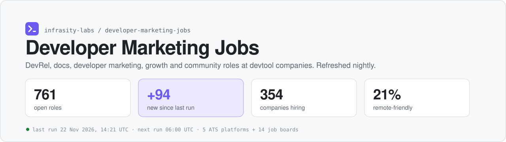
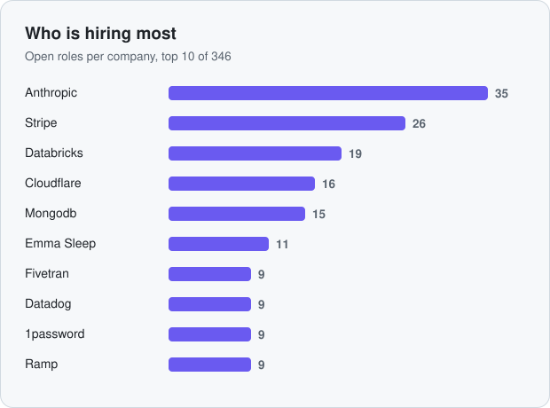
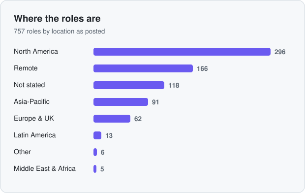
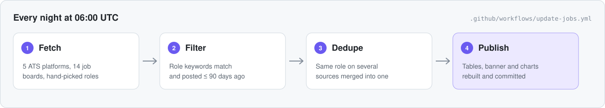

  

  <picture>
    <source media="(prefers-color-scheme: dark)" srcset="./.github/assets/banner-dark.svg">
    
  </picture>

  
  
  
  
  

  <b>Every open DevRel, technical writing, developer marketing, growth and community role at devtool companies, in one place.</b> 
  Pulled from company applicant tracking systems and niche job boards. Free, no signup, no recruiter spam.

  <a href="#browse-by-role"><b>Browse roles</b></a> &nbsp;·&nbsp;
  <a href="#market-snapshot"><b>Market snapshot</b></a> &nbsp;·&nbsp;
  <a href="#how-it-works"><b>How it works</b></a> &nbsp;·&nbsp;
  <a href="#post-a-role"><b>Post a role</b></a> &nbsp;·&nbsp;
  <a href="https://github.com/Infrasity-Labs/developer-marketing-jobs/subscription"><b>Watch for updates</b></a>

<!-- JOBS:START -->

## Browse by role

| Role family | Open | New | |
|:--|--:|--:|:--|
| [Developer Advocate / DevRel](#developer-advocate--devrel) | **53** | +5 | <picture>   <source media="(prefers-color-scheme: dark)" srcset="./.github/assets/bars/devrel-dark.svg">    </picture> |
| [Technical Writing & Documentation](#technical-writing--documentation) | **48** | +3 | <picture>   <source media="(prefers-color-scheme: dark)" srcset="./.github/assets/bars/docs-dark.svg">    </picture> |
| [Developer Marketing](#developer-marketing) | **99** | +4 | <picture>   <source media="(prefers-color-scheme: dark)" srcset="./.github/assets/bars/devmkt-dark.svg">    </picture> |
| [Product Marketing](#product-marketing) | **262** | +39 | <picture>   <source media="(prefers-color-scheme: dark)" srcset="./.github/assets/bars/pmm-dark.svg">    </picture> |
| [Growth & Demand Generation](#growth--demand-generation) | **137** | +15 | <picture>   <source media="(prefers-color-scheme: dark)" srcset="./.github/assets/bars/growth-dark.svg">    </picture> |
| [Marketing Leadership](#marketing-leadership) | **56** | +5 | <picture>   <source media="(prefers-color-scheme: dark)" srcset="./.github/assets/bars/leadership-dark.svg">    </picture> |
| [Community](#community) | **32** | +3 | <picture>   <source media="(prefers-color-scheme: dark)" srcset="./.github/assets/bars/community-dark.svg">    </picture> |
| [Full Stack Marketing](#full-stack-marketing) | **1** | — | <picture>   <source media="(prefers-color-scheme: dark)" srcset="./.github/assets/bars/fullstack-dark.svg">    </picture> |
| [SEO / GEO / AEO](#seo--geo--aeo) | **30** | +3 | <picture>   <source media="(prefers-color-scheme: dark)" srcset="./.github/assets/bars/seo-dark.svg">    </picture> |
| [Y Combinator Startups](#y-combinator-startups) | **0** | — | <picture>   <source media="(prefers-color-scheme: dark)" srcset="./.github/assets/bars/yc-dark.svg">    </picture> |

Bars share one scale. The darker part of each bar is roles added in the last run.

## Market snapshot

<picture>
  <source media="(prefers-color-scheme: dark)" srcset="./.github/assets/top-companies-dark.svg">
  
</picture>
<picture>
  <source media="(prefers-color-scheme: dark)" srcset="./.github/assets/regions-dark.svg">
  
</picture>

<picture>
  <source media="(prefers-color-scheme: dark)" srcset="./.github/assets/source-mix-dark.svg">
  
</picture>

<b>Where the jobs come from</b>

| Type | Sources |
|:--|:--|
| **ATS platforms (5)** | [Greenhouse](https://www.greenhouse.com) · [Lever](https://www.lever.co) · [Ashby](https://www.ashbyhq.com) · [Workable](https://www.workable.com) · [Y Combinator](https://www.ycombinator.com/jobs) |
| **Job boards (14)** | RemoteOK · Remotive · Adzuna · Arbeitnow · Jobicy · Himalayas · We Work Remotely · The Muse · DevRelJobs · DevRelJob · TheMinCave · DevToolJobs · ExitFive · Superpath |
| **Hand-curated** | Roles from LinkedIn and elsewhere, added in [`manual_jobs.json`](./manual_jobs.json) |

Links go to the company's own posting wherever one exists, not a reposted copy.

## Developer Advocate / DevRel

Advocates, evangelists and developer-experience engineers who help developers adopt a product through talks, sample code, content and community feedback. 
<b>53</b> open · <b>5</b> new since the last run · <a href="#browse-by-role">back to top ↑</a>

| Role | Company | Location | |
|:--|:--|:--|:-:|
| **Developer Success Engineer**  | Finch | San Francisco, New York City | [Apply ↗](https://jobs.lever.co/finch/6784cf1d-4a6a-4188-89a4-4b32f4ad67dc) |
| **Principal, Developer Marketing**  | Snowplow | Remote | [Apply ↗](https://devtooljobs.com/marketing/principal-developer-marketing-snowplow-70150519) |
| **Manager, Developer Relations - Open Source**  | Databricks | San Francisco, California | [Apply ↗](https://databricks.com/company/careers/open-positions/job?gh_jid=8716189002) |
| **Sr. Developer Advocate, Open Source — Omnigent**  | Databricks | Seattle, Washington | [Apply ↗](https://databricks.com/company/careers/open-positions/job?gh_jid=8716730002) |
| **Senior Developer Advocate**  | Elastic | Greece | [Apply ↗](https://jobs.elastic.co/jobs?gh_jid=8283694&gh_jid=8283694) |
| **Principal AI Developer Experience Engineer** | Atomcomputing | Boulder, CO | [Apply ↗](https://jobs.lever.co/atomcomputing/3378aa55-86c5-449f-b3e9-0ebb73d8ee0b) |
| **Database Developer, Marketing Technologies** | Datalabusa | Germantown, MD | [Apply ↗](https://jobs.lever.co/datalabusa/10b3bbfe-2ce3-4ae3-8384-dcf35736cd70) |
| **Head of Developer Experience (DevEx)** | Bloomon | London | [Apply ↗](https://jobs.lever.co/bloomon/db8c8eeb-05aa-4ee2-8c47-fa960e8dfc33) |

<b>Show 45 more Developer Advocate / DevRel roles</b>

| Role | Company | Location | |
|:--|:--|:--|:-:|
| **Developer Advocate** | Metabase | Remote-US | [Apply ↗](https://jobs.lever.co/metabase/0559088a-66e6-4cd3-9bfe-3cf03baaaba5) |
| **Developer Relations** | Logrocket | Boston or NYC | [Apply ↗](https://jobs.lever.co/logrocket/6d7fc949-6d48-4781-a0e4-77b4c48b5be8) |
| **Senior Developer Success Engineer** | Finch | San Francisco, New York City | [Apply ↗](https://jobs.lever.co/finch/d4c60202-800e-4bf8-b1c3-bf87b5cb472f) |
| **Developer Relations** | Nibiru | Remote - North America | [Apply ↗](https://jobs.lever.co/nibiru/189b8ceb-5552-4735-8e07-062e48ed1599) |
| **Senior Developer Advocate** | Gitlab | Remote, Canada; Remote, United States | [Apply ↗](https://job-boards.greenhouse.io/gitlab/jobs/8838202002) |
| **Developer Success Engineer, P2** | Twilio | Remote - US | [Apply ↗](https://job-boards.greenhouse.io/twilio/jobs/8266975) |
| **Senior Product Manager - Developer Experience** | Adyen | Amsterdam | [Apply ↗](https://job-boards.greenhouse.io/adyen/jobs/7941728) |
| **Senior Software Engineer, Developer Experience** | Coreweave | Livingston, NJ / New York, NY / Sunnyva… | [Apply ↗](https://coreweave.com/careers/job?4678602006&board=coreweave&gh_jid=4678602006) |
| **Staff Software Engineer, Developer Experience** | Coreweave | Livingston, NJ / New York, NY / Sunnyva… | [Apply ↗](https://coreweave.com/careers/job?4678600006&board=coreweave&gh_jid=4678600006) |
| **Sr. Developer Advocate, AI and Machine Learning** | Databricks | San Francisco, California | [Apply ↗](https://databricks.com/company/careers/open-positions/job?gh_jid=8716192002) |
| **Product Manager - Developer Experience, Bridge** | Stripe | San Francisco Or New York | [Apply ↗](https://stripe.com/jobs/search?gh_jid=8204227) |
| **Product Manager, Terminal Developer Experiences** | Stripe | San Francisco, Seattle | [Apply ↗](https://stripe.com/jobs/search?gh_jid=7586413) |
| **Senior Software Engineer, Developer Experience** | Fivetran | Novi Sad, South Bačka, Serbia, EMEA | [Apply ↗](https://www.fivetran.com/careers/job?gh_jid=8041168003) |
| **Staff Product Manager, AI & Developer Experience** | Fivetran | Denver, Colorado, United States, AMER | [Apply ↗](https://www.fivetran.com/careers/job?gh_jid=7894337003) |
| **Software Engineer - Developer Experience** | Figma | San Francisco, CA • New York, NY • Unit… | [Apply ↗](https://boards.greenhouse.io/figma/jobs/5790627004?gh_jid=5790627004) |
| **Developer Advocate, Lune** | Zenlayer | Diamond Bar, CA | [Apply ↗](https://www.linkedin.com/jobs/search/?keywords=Developer+Advocate%2C+Lune+Zenlayer&f_TPR=r604800) |
| **Field Product & Developer Evangelist- HQ, Santa Clara** | Agora | Santa Clara, CA | [Apply ↗](https://www.linkedin.com/jobs/search/?keywords=Field+Product+%26+Developer+Evangelist-+HQ%2C+Santa+Clara+Agora&f_TPR=r604800) |
| **VoidZero Developer Relations Engineer** | Cloudflare | Hybrid | [Apply ↗](https://boards.greenhouse.io/cloudflare/jobs/8190563?gh_jid=8190563) |
| **Developer Relations, Platform** | Anthropic | San Francisco, CA / New York City, NY | [Apply ↗](https://job-boards.greenhouse.io/anthropic/jobs/5206870008) |
| **Developer Evangelist** | Twilio | Remote - US | [Apply ↗](https://job-boards.greenhouse.io/twilio/jobs/8396809) |
| **AI Developer Experience Engineer** | Planetscale | Remote US | [Apply ↗](https://job-boards.greenhouse.io/planetscale/jobs/4463390009) |
| **DevRel Engineer, Agentic Infrastructure** | Vercel | Hybrid - San Francisco, New York City… | [Apply ↗](https://job-boards.greenhouse.io/vercel/jobs/6122437004) |
| **Developer Advocate, Payload** | Figma | San Francisco, CA • New York, NY • Unit… | [Apply ↗](https://boards.greenhouse.io/figma/jobs/6231582004?gh_jid=6231582004) |
| **Software Engineer – Developer Experience & AI Platform** | Idme | McLean, Virginia | [Apply ↗](https://job-boards.greenhouse.io/idme/jobs/8039485003) |
| **Developer Advocate - Service Management** | Datadog | California, USA, Remote; New York, USA… | [Apply ↗](https://careers.datadoghq.com/detail/8139662/?gh_jid=8139662) |
| **Developer Advocate - Service Management EMEA** | Datadog | France, Remote; Spain, Remote; The Neth… | [Apply ↗](https://careers.datadoghq.com/detail/8161455/?gh_jid=8161455) |
| **Senior Developer Advocate - Modern App Development** | Datadog | California, USA, Remote; Nevada, USA, R… | [Apply ↗](https://careers.datadoghq.com/detail/7985840/?gh_jid=7985840) |
| **Senior Developer Experience Engineer, Integrations** | Customerio | Americas Remote | [Apply ↗](https://job-boards.greenhouse.io/customerio/jobs/8076081) |
| **Developer Relations Manager, Claude Platform** | Anthropic | San Francisco, CA / New York City, NY | [Apply ↗](https://job-boards.greenhouse.io/anthropic/jobs/5367562008) |
| **Staff DX Engineer** | Render | — | [Apply ↗](https://www.devreljobs.com/jobs/staff-dx-engineer-render-1143) |
| **Senior Developer Relations, Twitter Brand Rep** | Supabase | — | [Apply ↗](https://www.devreljobs.com/jobs/senior-developer-relations-twitter-brand-rep-supabase-1141) |
| **Staff Developer Relations Engineer** | Render | — | [Apply ↗](https://www.devreljobs.com/jobs/staff-developer-relations-engineer-render-1140) |
| **Senior Director, Developer Relations** | Twilio | — | [Apply ↗](https://www.devreljobs.com/jobs/senior-director-developer-relations-twilio-1138) |
| **Developer Advocate, Edge & IoT** | Telnyx | — | [Apply ↗](https://www.devreljobs.com/jobs/developer-advocate-edge-iot-telnyx-1137) |
| **Senior Developer Advocate - Volcano** | Kong | — | [Apply ↗](https://www.devreljobs.com/jobs/senior-developer-advocate-volcano-kong-1135) |
| **Developer Advocate** | ElevenLabs | — | [Apply ↗](https://www.devreljobs.com/jobs/developer-advocate-elevenlabs-1134) |
| **Senior Developer Advocate** | Neo4j | — | [Apply ↗](https://www.devreljobs.com/jobs/senior-developer-advocate-neo4j-1132) |
| **Technical Community Manager** | Together AI | — | [Apply ↗](https://www.devreljobs.com/jobs/technical-community-manager-together-ai-1128) |
| **Developer Experience Engineer, Cyber** | OpenAI | — | [Apply ↗](https://www.devreljobs.com/jobs/developer-experience-engineer-cyber-openai-1125) |
| **Technical Program Manager, Developer Experience** | OpenAI | — | [Apply ↗](https://www.devreljobs.com/jobs/technical-program-manager-developer-experience-openai-1120) |
| **Developer Experience Engineer** | ElevenLabs | — | [Apply ↗](https://www.devreljobs.com/jobs/developer-experience-engineer-elevenlabs-1119) |
| **Developer Relations Engineer** | Supabase | — | [Apply ↗](https://www.devreljobs.com/jobs/developer-relations-engineer-supabase-1118) |
| **Senior Software Engineer, AI Developer Experience** | Vanta | Remote | [Apply ↗](https://jobs.ashbyhq.com/vanta/112c82ea-5825-4121-a43f-5e1902bec35c) |
| **Senior Developer Marketing Manager, Social & Content** | 1password | Remote | [Apply ↗](https://jobs.ashbyhq.com/1password/6d3c1adb-7100-4a28-9f3f-11af3427f71d) |
| **Senior Developer Marketing Manager, Lifecycle & Growth** | 1password | Remote | [Apply ↗](https://jobs.ashbyhq.com/1password/2925531c-43d3-4999-8537-c156762434a9) |

## Technical Writing & Documentation

Technical writers, docs engineers and information architects who own documentation, API references and developer guides. 
<b>48</b> open · <b>3</b> new since the last run · <a href="#browse-by-role">back to top ↑</a>

| Role | Company | Location | |
|:--|:--|:--|:-:|
| **Technical Writer**  | Palantir | New York, NY | [Apply ↗](https://jobs.lever.co/palantir/95a76f41-97a4-4696-ade3-9c5a47a569c7) |
| **Senior Technical Content Writer**  | bunny.net | Remote | [Apply ↗](https://devtooljobs.com/marketing/senior-technical-content-writer-bunny-net-21949733) |
| **Documentation Engineer (m/w/x)**  | K-tronik GmbH | — | [Apply ↗](https://www.arbeitnow.com/jobs/companies/k-tronik-gmbh/documentation-engineer-berlin-144723) |
| **Technical Writer** | Hevodata | Bangalore, India | [Apply ↗](https://jobs.lever.co/hevodata/3f239b8e-6773-456a-8da2-d992b927c65c) |
| **Business Process Documentation Specialist / SOP Documentation Analyst- R01573286** | Brillio 2 | Edison, New Jersey, United States | [Apply ↗](https://jobs.lever.co/brillio-2/ad47c4e9-b54e-487f-9f71-4e23958ff4de) |
| **Technical Writer - India** | Jumpcloud | Bangalore, India - Remote | [Apply ↗](https://jobs.lever.co/jumpcloud/7e142e32-874c-4dbe-a8fc-96284503c553) |
| **Technical Writer & Editor III** | Arsiem | Arlington, VA | [Apply ↗](https://jobs.lever.co/arsiem/e1b1e38e-a3d1-48b3-b14c-26edd1b79375) |
| **Technical Content Engineer** | Pigment | Paris | [Apply ↗](https://jobs.lever.co/pigment/94474b0b-a64a-4816-adb4-73037fcd8b97) |

<b>Show 40 more Technical Writing & Documentation roles</b>

| Role | Company | Location | |
|:--|:--|:--|:-:|
| **Senior Technical Writer, Support Documentation** | Fullscript | Ottawa, ON | [Apply ↗](https://jobs.lever.co/fullscript/da672c0a-c946-4a6c-a4ed-97aa7ca9bca0) |
| **Technical Writer** | Crestoperations | Pineville, Louisiana | [Apply ↗](https://jobs.lever.co/crestoperations/254859cf-7b03-4a09-b0d1-b8d86877ea59) |
| **Quantum Information Architecture Lead** | Dodmg | Malibu, CA | [Apply ↗](https://jobs.lever.co/dodmg/5296e2a5-e652-4877-94dd-5643e7d8a313) |
| **Technical Content Strategist & Editor** | Educative | Lahore | [Apply ↗](https://jobs.lever.co/educative/811c5d48-607c-4261-a8fc-5bf93d8ef36a) |
| **Technical Writer (CBP)** | Agile Defense | Ashburn, VA | [Apply ↗](https://jobs.lever.co/agile-defense/4d37db04-1b03-4156-9ef1-215b0234bf3f) |
| **Technical Writer (TW) – SME** | Cgsfederal | Washington, DC | [Apply ↗](https://jobs.lever.co/cgsfederal/f039b8a4-d237-474b-b4d3-1f307881a6b3) |
| **Technical Writer (TW) – Senior** | Cgsfederal | Washington, DC | [Apply ↗](https://jobs.lever.co/cgsfederal/8267ff6c-906e-4ff3-8e78-a7396bb3ae29) |
| **Technical Writer (TW) – Journeyman** | Cgsfederal | Washington, DC | [Apply ↗](https://jobs.lever.co/cgsfederal/9855aeb2-6587-4de4-a741-b2716d3b7fa9) |
| **Technical Writer (TW) – Junior** | Cgsfederal | Washington, DC | [Apply ↗](https://jobs.lever.co/cgsfederal/b1cc6054-6585-4da1-b07e-0a5e76f49d16) |
| **Senior Technical Writer (Top Secret Clearance Required)** | Cgsfederal | Washington, DC | [Apply ↗](https://jobs.lever.co/cgsfederal/8d8baae8-0bc2-4a97-a8c1-251e8132b428) |
| **Senior Technical Writer** | Cgsfederal | Los Angeles, CA | [Apply ↗](https://jobs.lever.co/cgsfederal/041185bc-bd1d-438c-83f2-a8cbe41f1ff8) |
| **Director, Information Architect** | Cimgroup | Los Angeles, CA | [Apply ↗](https://jobs.lever.co/cimgroup/e4942b3b-d317-4f7d-aaa0-a4e319a7daf6) |
| **Intelligence Technical Writer** | Cgsfederal | Fort Liberty, NC | [Apply ↗](https://jobs.lever.co/cgsfederal/d24b3907-bf58-4b5a-a035-0195072b8438) |
| **Technical Editor (TS/SCI Cleared)** | Latitudeinc | Fort Belvoir, VA | [Apply ↗](https://jobs.lever.co/latitudeinc/fc1034da-9392-449a-98f8-c2c9d413d618) |
| **Technical Content Writer** | Mactores | Mumbai, MH | [Apply ↗](https://jobs.lever.co/mactores/e5bedb87-283a-4e12-8fe0-004499f2514b) |
| **Senior Technical Content Engineers (Islamabad)** | Educative | Islamabad | [Apply ↗](https://jobs.lever.co/educative/0ee86a3d-2645-4c5e-8c72-6b8f6e68a1d5) |
| **Senior Technical Content Engineers** | Educative | Lahore | [Apply ↗](https://jobs.lever.co/educative/c33cd8ef-043a-47b0-9454-561e6cd17e5c) |
| **Technical Content Engineer** | Educative | Lahore | [Apply ↗](https://jobs.lever.co/educative/b065fdf1-680f-47e0-ad0f-08b67528ae98) |
| **Manager, Technical Writer** | Mongodb | Bengaluru; Gurugram; Mumbai | [Apply ↗](https://www.mongodb.com/careers/job/?gh_jid=8230883) |
| **Senior Technical Writer** | Mongodb | Bengaluru; Gurugram; Mumbai | [Apply ↗](https://www.mongodb.com/careers/job/?gh_jid=8231370) |
| **Staff Technical Writer** | Fivetran | Bengaluru, Karnataka, India, APAC | [Apply ↗](https://www.fivetran.com/careers/job?gh_jid=8010276003) |
| **Technical Writer** | Applied Medical | Rancho Santa Margarita, CA | [Apply ↗](https://www.linkedin.com/jobs/search/?keywords=Technical+Writer+Applied+Medical&f_TPR=r604800) |
| **Staff Technical Writer** | AMD | Albuquerque, NM | [Apply ↗](https://www.linkedin.com/jobs/search/?keywords=Staff+Technical+Writer+AMD&f_TPR=r604800) |
| **Technical Writer I** | Saalex Solutions - A Saalex Company | United States | [Apply ↗](https://www.linkedin.com/jobs/search/?keywords=Technical+Writer+I+Saalex+Solutions+-+A+Saalex+Company&f_TPR=r604800) |
| **TECHNICAL EDITOR AND WRITER 3** | Ingalls Shipbuilding, a Division of HII | Avondale, LA | [Apply ↗](https://www.linkedin.com/jobs/search/?keywords=TECHNICAL+EDITOR+AND+WRITER+3+Ingalls+Shipbuilding%2C+a+Division+of+HII&f_TPR=r604800) |
| **Technical Writer and Editor** | General Atomics Aeronautical Systems | Salina, KS | [Apply ↗](https://www.linkedin.com/jobs/search/?keywords=Technical+Writer+and+Editor+General+Atomics+Aeronautical+Systems&f_TPR=r604800) |
| **TECHNICAL EDITOR AND WRITER 3** | HII | Avondale, LA | [Apply ↗](https://www.linkedin.com/jobs/search/?keywords=TECHNICAL+EDITOR+AND+WRITER+3+HII&f_TPR=r604800) |
| **Technical Author** | Safran | Isle Of Wight, England, United Kingdom | [Apply ↗](https://www.linkedin.com/jobs/search/?keywords=Technical+Author+Safran&f_TPR=r604800) |
| **Technical Writer** | Abacus Technology Corporation | San Antonio, TX | [Apply ↗](https://www.linkedin.com/jobs/search/?keywords=Technical+Writer+Abacus+Technology+Corporation&f_TPR=r604800) |
| **Technical Writer** | Verisk | Boston, MA | [Apply ↗](https://www.linkedin.com/jobs/search/?keywords=Technical+Writer+Verisk&f_TPR=r604800) |
| **Technical writer- CVG 100** | Jabil | Florence, KY | [Apply ↗](https://www.linkedin.com/jobs/search/?keywords=Technical+writer-+CVG+100+Jabil&f_TPR=r604800) |
| **Technical Writer** | PrideNow | Foster City, CA | [Apply ↗](https://www.linkedin.com/jobs/search/?keywords=Technical+Writer+PrideNow&f_TPR=r604800) |
| **Staff Technical Writer** | Gitlab | Remote, Canada; Remote, Poland; Remote… | [Apply ↗](https://job-boards.greenhouse.io/gitlab/jobs/8922693002) |
| **Technical Writer** | Red Arch Solutions | Reston, VA | [Apply ↗](https://www.linkedin.com/jobs/search/?keywords=Technical+Writer+Red+Arch+Solutions&f_TPR=r604800) |
| **Senior Technical Writer** | Red Arch Solutions | Reston, VA | [Apply ↗](https://www.linkedin.com/jobs/search/?keywords=Senior+Technical+Writer+Red+Arch+Solutions&f_TPR=r604800) |
| **Docs Lead, Platform** | Anthropic | San Francisco, CA / New York City, NY | [Apply ↗](https://job-boards.greenhouse.io/anthropic/jobs/5482310008) |
| **Technical Writer II** | Bloomreach | Slovakia | [Apply ↗](https://job-boards.greenhouse.io/bloomreach/jobs/8364924) |
| **Technical Content Lead (EA or CPA required)** | Collective | — | [Apply ↗](https://jobs.superpath.co) |
| **Senior Technical Content Writer** | bunny.net | — | [Apply ↗](https://jobs.superpath.co) |
| **Senior Technical Writer-Editor** | NSF | — | [Apply ↗](https://jobs.superpath.co) |

## Developer Marketing

Marketers who reach a technical audience: content, campaigns, lifecycle and growth aimed at developers. 
<b>99</b> open · <b>4</b> new since the last run · <a href="#browse-by-role">back to top ↑</a>

| Role | Company | Location | |
|:--|:--|:--|:-:|
| **Social Content Manager**  | Buyerlink | Victoria, Capital | [Apply ↗](https://www.adzuna.ca/details/5977219875?utm_medium=api&utm_source=1aa7baa7) |
| **Content Marketing Lead**  | Verda | Remote | [Apply ↗](https://devtooljobs.com/marketing/content-marketing-lead-verda-31153853) |
| **Content Marketing Specialist**  | Scaleway | Remote | [Apply ↗](https://devtooljobs.com/marketing/content-marketing-specialist-scaleway-98449392) |
| **Event & Content Managerin/Manager**  | Swiss Innovation Forces | — | [Apply ↗](https://www.arbeitnow.ch/jobs/companies/swiss-innovation-forces/event-content-managerin-manager-zurich-19627) |
| **Creative Director** | Luxurypresence | United States | [Apply ↗](https://jobs.lever.co/luxurypresence/7615427e-3bf6-4f45-9464-740633cc66ef) |
| **Senior Marketing Manager, Brand Marketing** | Coatesgroup | Sydney | [Apply ↗](https://jobs.lever.co/coatesgroup/c29efb1c-684b-49e9-8b3b-ca1d3bd78589) |
| **Director, Retail & Wholesale Revenue** | Pendulum | Remote | [Apply ↗](https://jobs.lever.co/pendulum/af6cd303-c644-4f2a-bcf2-206017afb091) |
| **Marketing Coordinator - Design, Digital & Content** | Outsourcedstaff | Philippines | [Apply ↗](https://jobs.lever.co/outsourcedstaff/860013bd-ead0-4923-9653-be158b21f018) |

<b>Show 91 more Developer Marketing roles</b>

| Role | Company | Location | |
|:--|:--|:--|:-:|
| **Content Strategist** | Packagex | Islamabad,PK | [Apply ↗](https://jobs.lever.co/packagex/9dbb2410-da3a-4867-b926-16d55386c3bb) |
| **Content Strategist** | Nobody | Washington, DC, Durham, NC, Richmond, V… | [Apply ↗](https://jobs.lever.co/nobody/26817870-98cb-4152-a76c-a97e52626434) |
| **Senior Methodology and Content Manager** | Caseware | Toronto, ON | [Apply ↗](https://jobs.lever.co/caseware/83428085-e79f-453d-8a61-70e757f23a15) |
| **Content Marketing Manager - Industrial B2B** | Mendix | United States | [Apply ↗](https://jobs.lever.co/mendix/acded4ba-2f4e-4562-8091-30fa5b661b8a) |
| **Senior Content Marketing Manager** | Influ2 | United States | [Apply ↗](https://jobs.lever.co/influ2/9107d4cb-c534-433f-af7e-01960cde94b4) |
| **Senior Social Media Specialist, MENA & Global LinkedIn** | Capital | Dubai | [Apply ↗](https://jobs.lever.co/capital/2d8743fb-6c8f-4487-a87d-1a318c6b0538) |
| **Brand Marketing Executive** | Hypebeast | Hong Kong | [Apply ↗](https://jobs.lever.co/hypebeast/324a111e-a565-439f-9015-db56231c82cc) |
| **Multimedia Project Management - Intern** | Extremenetworks | Thornhill, Canada | [Apply ↗](https://jobs.lever.co/extremenetworks/5cb8361e-6415-4fcd-a51c-73c73c7049db) |
| **Brand Marketing Manager** | Coins | Taguig City, Metro Manila, Philippines | [Apply ↗](https://jobs.lever.co/coins/1f2c9f0f-f820-47f1-8263-86e99d135a41) |
| **Content Manager, Reverse Mortgage** | Eqbank | Toronto | [Apply ↗](https://jobs.lever.co/eqbank/a6d75eff-2555-4cf2-b36e-c4f0413331ca) |
| **Brand Marketing Manager** | Nahc | Taipei City, Taiwan | [Apply ↗](https://jobs.lever.co/nahc/bf5c647b-f4be-4dbe-9748-fc079339fa0b) |
| **Sr. Social Media Manager** | Luxurypresence | New York, NY | [Apply ↗](https://jobs.lever.co/luxurypresence/3393a3e3-6a33-4a97-a668-96c1b899928f) |
| **Marketing Content & Communication Intern - Shanghai - Oct 2026** | Ekimetrics | Shanghai | [Apply ↗](https://jobs.lever.co/ekimetrics/aeb984e6-7866-48ac-acdc-8609d8ae82ff) |
| **Content Marketing Associate** | Educative | Lahore | [Apply ↗](https://jobs.lever.co/educative/aebecc5e-8559-47cb-a564-b59aa2da44c1) |
| **Sr. Brand Marketing Manager** | Blueland | New York, NY | [Apply ↗](https://jobs.lever.co/blueland/ad5ea7f0-917f-40ac-abe0-49652847a886) |
| **Head of Brand Marketing** | Pigment | San Francisco or New York | [Apply ↗](https://jobs.lever.co/pigment/b3a50b11-6e09-4dd5-9e24-f16f17fdcb5e) |
| **Director, Healthcare Revenue** | Pendulum | San Francisco, CA | [Apply ↗](https://jobs.lever.co/pendulum/b99f4a5e-eaaa-4120-b9bd-1a6b62cf6702) |
| **Multimedia Content Manager** | Feldinc | Ellenton, Florida - E-Verify | [Apply ↗](https://jobs.lever.co/feldinc/2b53eb78-f78e-408f-977f-7d67621a4595) |
| **Content Strategist** | Life | Edmond, OK | [Apply ↗](https://jobs.lever.co/life/b711e94b-1227-4f31-82aa-9c2977371c41) |
| **Content Strategist** | Microventures | Austin, TX | [Apply ↗](https://jobs.lever.co/microventures/a100da58-09d8-468a-aeb5-a7d3de2c9ff0) |
| **Social Media Content Strategist - Freelance (H/F/X)** | Biggie | Paris | [Apply ↗](https://jobs.lever.co/biggie/27879382-610c-44bc-8cf5-23f5de2127c4) |
| **Director, Brand Marketing** | Mongodb | United States | [Apply ↗](https://www.mongodb.com/careers/job/?gh_jid=8304692) |
| **Director, Content Marketing** | Fivetran | Remote | [Apply ↗](https://devtooljobs.com/marketing/director-content-marketing-fivetran-46812964) |
| **Senior B2B Content Marketing Manager, Global** | Adyen | Amsterdam | [Apply ↗](https://job-boards.greenhouse.io/adyen/jobs/7895373) |
| **Briefing Content Strategist** | Stripe | Remote in the US | [Apply ↗](https://stripe.com/jobs/search?gh_jid=8376773) |
| **Writer, Content Marketing** | Stripe | US Hybrid | [Apply ↗](https://stripe.com/jobs/search?gh_jid=8265686) |
| **Content Marketing Manager** | ZeroFox | Baltimore, MD | [Apply ↗](https://www.linkedin.com/jobs/search/?keywords=Content+Marketing+Manager+ZeroFox&f_TPR=r604800) |
| **Brand and Content Marketing Manager, North America** | Audible | Culver City, CA | [Apply ↗](https://www.linkedin.com/jobs/search/?keywords=Brand+and+Content+Marketing+Manager%2C+North+America+Audible&f_TPR=r604800) |
| **Brand and Content Manager** | Act | United States | [Apply ↗](https://www.linkedin.com/jobs/search/?keywords=Brand+and+Content+Manager+Act&f_TPR=r604800) |
| **Event Content Strategist** | Elastic | United States | [Apply ↗](https://jobs.elastic.co/jobs?gh_jid=8359528&gh_jid=8359528) |
| **Regional Content Strategist, Global Public Sector** | Elastic | United States | [Apply ↗](https://jobs.elastic.co/jobs?gh_jid=8349732&gh_jid=8349732) |
| **Senior Brand Marketing Manager** | Circleci | San Francisco | [Apply ↗](http://www.circleci.com/careers/jobs/8881662002/?gh_jid=8881662002) |
| **Content Strategist, Product** | Figma | San Francisco, CA • New York, NY • Unit… | [Apply ↗](https://boards.greenhouse.io/figma/jobs/6207950004?gh_jid=6207950004) |
| **Developer Marketer - Sales** | PostHog | San Francisco, CA | [Apply ↗](https://jobs.ashbyhq.com/posthog/82ef4227-e7a6-4e59-a128-2b3333951e21) |
| **Content Marketing Specialist (Founder-Led Content)** | Virayo | Anywhere Remote only | [Apply ↗](https://jobs.exitfive.com/job/2583309-content-marketing-specialist-founder-led-content-virayo) |
| **Content Leader** | Full-time | — | [Apply ↗](https://jobs.superpath.co) |
| **Senior Content Manager** | PolyAI | — | [Apply ↗](https://jobs.superpath.co) |
| **Content Marketing Manager (m/f/d)** | EGYM | — | [Apply ↗](https://jobs.superpath.co) |
| **Content Marketing Manager (f/m/x)** | Integrated Systems Events | — | [Apply ↗](https://jobs.superpath.co) |
| **AI Content Marketing Manager (f/m/d) B2B** | IONOS | — | [Apply ↗](https://jobs.superpath.co) |
| **Content Marketing Manager** | Gecko Robotics | — | [Apply ↗](https://jobs.superpath.co) |
| **Senior Global Content Lead** | Proxima (Bain & Company) | — | [Apply ↗](https://jobs.superpath.co) |
| **Content Lead** | REGENT | — | [Apply ↗](https://jobs.superpath.co) |
| **Growth Content Manager** | Plain | — | [Apply ↗](https://jobs.superpath.co) |
| **Senior Content Lead** | Aaru | — | [Apply ↗](https://jobs.superpath.co) |
| **Senior Content Manager** | Truveta | — | [Apply ↗](https://jobs.superpath.co) |
| **Community & Content Manager, North America** | FirstWork | — | [Apply ↗](https://jobs.superpath.co) |
| **Communications & Content Lead** | Anyfin | — | [Apply ↗](https://jobs.superpath.co) |
| **Senior Content Marketing Manager** | Artemis | — | [Apply ↗](https://jobs.superpath.co) |
| **SEO Content Manager** | Checkatrade | — | [Apply ↗](https://jobs.superpath.co) |
| **Senior Content Marketing Manager** | LinkedIn | — | [Apply ↗](https://jobs.superpath.co) |
| **Copywriter & Content Manager – DACH** | Reolink | — | [Apply ↗](https://jobs.superpath.co) |
| **Content Marketing Manager** | Appinio | — | [Apply ↗](https://jobs.superpath.co) |
| **Content Marketing Lead** | Blink - The Employee App | — | [Apply ↗](https://jobs.superpath.co) |
| **Strategy and Content Lead** | Vovi | — | [Apply ↗](https://jobs.superpath.co) |
| **Writer, Content Marketing** | Stripe | — | [Apply ↗](https://jobs.superpath.co) |
| **Sr. Content Marketing Manager** | Quantexa | — | [Apply ↗](https://jobs.superpath.co) |
| **Content Marketing Manager** | MIND | — | [Apply ↗](https://jobs.superpath.co) |
| **Content Lead** | Nooks.ai | — | [Apply ↗](https://jobs.superpath.co) |
| **Content Marketing Manager - 6 month ftc** | PortSwigger | — | [Apply ↗](https://jobs.superpath.co) |
| **Comms & Content Marketing Lead** | Fynapse | — | [Apply ↗](https://jobs.superpath.co) |
| **Content Lead** | Endex | — | [Apply ↗](https://jobs.superpath.co) |
| **Content Manager - Spanish Speaking** | Payhawk | — | [Apply ↗](https://jobs.superpath.co) |
| **Content Marketing Manager** | Serval | — | [Apply ↗](https://jobs.superpath.co) |
| **Content Manager - French Speaking** | Payhawk | — | [Apply ↗](https://jobs.superpath.co) |
| **Senior Content Marketing Manager** | Onyx Security | — | [Apply ↗](https://jobs.superpath.co) |
| **Content Marketing Lead** | TripleTen | — | [Apply ↗](https://jobs.superpath.co) |
| **Content Marketing Manager** | Fulfillment IQ | — | [Apply ↗](https://jobs.superpath.co) |
| **Senior Content Marketing Manager** | OneSignal | — | [Apply ↗](https://jobs.superpath.co) |
| **Content Marketing Manager** | The Adaptavist Group | — | [Apply ↗](https://jobs.superpath.co) |
| **Content Marketing Lead** | TransPerfect | — | [Apply ↗](https://jobs.superpath.co) |
| **Content Marketing Manager** | Topline Pro | — | [Apply ↗](https://jobs.superpath.co) |
| **Brand + Content Manager** | Venture-backed AI manufacturing startup… | — | [Apply ↗](https://jobs.superpath.co) |
| **Demand & Content Marketing Lead / Responsable Marketing de la Demande et Contenu** | Sadie | — | [Apply ↗](https://jobs.superpath.co) |
| **Content Marketing Manager** | Rainforest | — | [Apply ↗](https://jobs.superpath.co) |
| **Content Marketing Manager** | Centuro Global | — | [Apply ↗](https://jobs.superpath.co) |
| **Principal Content Marketing Manager, LTS Integrated Marketing** | LinkedIn | — | [Apply ↗](https://jobs.superpath.co) |
| **Content Lead - The Longevity Show** | The Longevity Show | — | [Apply ↗](https://jobs.superpath.co) |
| **Content Marketing Writer** | Intellibright | — | [Apply ↗](https://jobs.superpath.co) |
| **Content Marketing Manager** | Amplitude | — | [Apply ↗](https://jobs.superpath.co) |
| **Senior Content Marketing Manager, Institutional** | Stellar Development Foundation | — | [Apply ↗](https://jobs.superpath.co) |
| **Content Marketing Lead** | Jitter | — | [Apply ↗](https://jobs.superpath.co) |
| **Content Lead** | ITRS | — | [Apply ↗](https://jobs.superpath.co) |
| **Content Marketing Manager** | Ambient.ai | — | [Apply ↗](https://jobs.superpath.co) |
| **Employee Storytelling & Content Manager** | Zscaler | — | [Apply ↗](https://jobs.superpath.co) |
| **Content Marketing Manager** | Rydoo | — | [Apply ↗](https://jobs.superpath.co) |
| **Senior Manager, Content Marketing** | Cogent Security | — | [Apply ↗](https://jobs.superpath.co) |
| **Content Lead** | Titan | — | [Apply ↗](https://jobs.superpath.co) |
| **Content Marketing Manager (EU)** | CoVet | — | [Apply ↗](https://jobs.superpath.co) |
| **Content Marketing Manager, Events** | OpenAI | — | [Apply ↗](https://jobs.superpath.co) |
| **Content Marketing Manager, SEO & AI Search** | Chime Financial, Inc | — | [Apply ↗](https://jobs.superpath.co) |

## Product Marketing

Positioning, messaging and launch roles that connect a product to its market and its buyers. 
<b>262</b> open · <b>39</b> new since the last run · <a href="#browse-by-role">back to top ↑</a>

| Role | Company | Location | |
|:--|:--|:--|:-:|
| **GTM Operations Analyst**  | Olo | NYC or Remote | [Apply ↗](https://jobs.lever.co/olo/3cbaa278-ca89-4a8b-a300-4e82c1834e81) |
| **Therapy Development Specialist**  | Penumbrainc | Your Remote US Home Office | [Apply ↗](https://jobs.lever.co/penumbrainc/1beb1423-3bf4-47a3-bb37-3068339b14c3) |
| **Strategic Account Director, EMEA**  | Cloudinary | London | [Apply ↗](https://jobs.lever.co/cloudinary/d797b9c7-5fe7-45f7-a80e-9bbc7db82ef3) |
| **Therapy Development Specialist, Northeast Region (VT, ME, MA, NY, NJ, PA, CT)**  | Penumbrainc | Your Remote US Home Office | [Apply ↗](https://jobs.lever.co/penumbrainc/8efadfbc-965f-4893-92de-faf9ebcf10b5) |
| **Marketing Manager**  | Penumbrainc | Alameda, CA | [Apply ↗](https://jobs.lever.co/penumbrainc/4f859c70-e739-4d05-b3b1-8042f8e019f2) |
| **Associate Marketing Manager - Fellowship and Society Engagement**  | Penumbrainc | Alameda, CA | [Apply ↗](https://jobs.lever.co/penumbrainc/2a59892e-0faf-4cb5-b817-d88356244f19) |
| **Therapy Development Specialist, Pacific Northwest Region (Seattle, WA; Portland, OR; San…**  | Penumbrainc | Seattle, WA | [Apply ↗](https://jobs.lever.co/penumbrainc/c5e4d34e-3ec5-4583-be64-978bd3804217) |
| **Vascular Product Marketing Manager for Poland (m/f/d) – ideally based in Warsaw or Krakow**  | Penumbrainc | Warsaw | [Apply ↗](https://jobs.lever.co/penumbrainc/cdd7f284-ed28-4ce2-9695-82b7366c8c11) |

<b>Show 254 more Product Marketing roles</b>

| Role | Company | Location | |
|:--|:--|:--|:-:|
| **Product Marketing Manager**  | Devtooljobs | Australia | [Apply ↗](https://www.adzuna.com.au/details/5976838492?utm_medium=api&utm_source=1aa7baa7) |
| **Global Senior Director of Product Marketing (4061)**  | GBG | Chester, Cheshire | [Apply ↗](https://www.adzuna.co.uk/jobs/details/5977312700?utm_medium=api&utm_source=1aa7baa7) |
| **Summer Internship / Books Product Marketing**  | LifeWay Christian Resources | United States | [Apply ↗](https://himalayas.app/companies/lifeway-christian-resources/jobs/summer-internship-books-product-marketing?utm_source=api) |
| **GTM Engineer, Growth**  | Enterpret | NewYork | [Apply ↗](https://job-boards.greenhouse.io/enterpret/jobs/8215308003) |
| **GTM Enablement & Operations Specialist**  | Varicent | Vancouver, Greater Vancouver | [Apply ↗](https://www.adzuna.ca/details/5977219861?utm_medium=api&utm_source=1aa7baa7) |
| **Director, Product Marketing & Strategy**  | Village Farms International | Delta, Leeds and Grenville | [Apply ↗](https://www.adzuna.ca/details/5977219092?utm_medium=api&utm_source=1aa7baa7) |
| **Product Marketing Manager, Hardware (Japan)**  | OpenAI | Remote | [Apply ↗](https://devtooljobs.com/marketing/product-marketing-manager-hardware-japan-openai-78513318) |
| **Product Marketing Manager, Hardware (Korea)**  | OpenAI | Remote | [Apply ↗](https://devtooljobs.com/marketing/product-marketing-manager-hardware-korea-openai-90742045) |
| **Senior Technical Product Marketing Manager**  | Teleport | Remote | [Apply ↗](https://devtooljobs.com/marketing/senior-technical-product-marketing-manager-teleport-82026884) |
| **Product Marketing Manager - US Remote**  | RudderStack | Remote | [Apply ↗](https://devtooljobs.com/marketing/product-marketing-manager-us-remote-rudderstack-24358402) |
| **Director of Product Marketing**  | Constructor | Remote | [Apply ↗](https://devtooljobs.com/marketing/director-of-product-marketing-constructor-97042962) |
| **Product Marketing Lead**  | Directus | Remote | [Apply ↗](https://devtooljobs.com/marketing/product-marketing-lead-directus-65501191) |
| **Product Marketing Manager**  | Merge | Remote | [Apply ↗](https://devtooljobs.com/marketing/product-marketing-manager-merge-98238357) |
| **Senior Product Marketing Manager**  | Teleport | Remote | [Apply ↗](https://devtooljobs.com/marketing/senior-product-marketing-manager-teleport-85171375) |
| **Director of Product Marketing**  | Telnyx | Remote | [Apply ↗](https://devtooljobs.com/marketing/director-of-product-marketing-telnyx-74597371) |
| **Senior Product Marketing Manager, AI Compute**  | Telnyx | Remote | [Apply ↗](https://devtooljobs.com/marketing/senior-product-marketing-manager-ai-compute-telnyx-45970432) |
| **Product Marketing Manager, Partners**  | Together AI | Remote | [Apply ↗](https://devtooljobs.com/marketing/product-marketing-manager-partners-together-ai-95588953) |
| **Technical Marketing Engineer**  | Together AI | Remote | [Apply ↗](https://devtooljobs.com/marketing/technical-marketing-engineer-together-ai-17207201) |
| **GTM Coordinator, Cloud Native (Talent Pool)**  | Percona | Remote | [Apply ↗](https://devtooljobs.com/marketing/gtm-coordinator-cloud-native-talent-pool-percona-45852174) |
| **Product Marketing Manager**  | Percona | Remote | [Apply ↗](https://devtooljobs.com/marketing/product-marketing-manager-percona-33350027) |
| **Solutions Marketing Manager (Remote)**  | Percona | Remote | [Apply ↗](https://devtooljobs.com/marketing/solutions-marketing-manager-remote-percona-83311817) |
| **Technical Product Marketing Manager**  | Sauce Labs | Remote | [Apply ↗](https://devtooljobs.com/marketing/technical-product-marketing-manager-sauce-labs-56298493) |
| **GTM Recruiter, Contract**  | Mongodb | United States | [Apply ↗](https://www.mongodb.com/careers/job/?gh_jid=8403443) |
| **Senior GTM Recruiter**  | Intercom | Chicago, Illinois | [Apply ↗](https://job-boards.greenhouse.io/intercom/jobs/8280050) |
| **Lead, Product Marketing — Decisioning Studio**  | Braze | San Francisco | [Apply ↗](https://job-boards.greenhouse.io/braze/jobs/8170821) |
| **GTM Talent Sourcer (Contract)**  | Databricks | Tokyo, Japan | [Apply ↗](https://databricks.com/company/careers/open-positions/job?gh_jid=8937105002) |
| **Product Marketing Manager, Knowledge Work - Enterprise**  | Anthropic | San Francisco, CA / New York City, NY | [Apply ↗](https://job-boards.greenhouse.io/anthropic/jobs/5470528008) |
| **Business Development Lead (Enterprise DACH)**  | Telli | — | [Apply ↗](https://www.arbeitnow.com/jobs/companies/telli/business-development-lead-enterprise-dach-berlin-16167) |
| **Senior Product Marketing Manager, Business Banking**  | Monzo | — | [Apply ↗](https://www.arbeitnow.co.uk/jobs/companies/monzo/senior-product-marketing-manager-business-banking-cardiff-288012) |
| **Director, GTM Operations**  | Zapier | Remote | [Apply ↗](https://jobs.ashbyhq.com/zapier/79f0aa77-7a24-4246-a623-a37fb2149de6) |
| **Associate, GTM Finance**  | Ramp | Remote | [Apply ↗](https://jobs.ashbyhq.com/ramp/b5bd9c30-4bc3-435e-aec1-43405474d317) |
| **Product Marketing Manager - Mexico** | Jumpcloud | Mexico City, Mexico - Remote | [Apply ↗](https://jobs.lever.co/jumpcloud/c401c627-8627-40ba-ac58-606b3940ad08) |
| **Product Marketing Manager** | Floqast | Los Angeles, California | [Apply ↗](https://jobs.lever.co/floqast/d0cb2dd7-7bd5-4928-824a-aeee6a21d998) |
| **Product Marketing Manager  (Accounting Experience)** | Floqast | Los Angeles, California | [Apply ↗](https://jobs.lever.co/floqast/283ea474-7976-4e87-9782-7ef408e54aab) |
| **Director of Product Marketing** | Cents | New York, NY | [Apply ↗](https://jobs.lever.co/cents/4a5f5527-7b0a-4909-a6f6-09031aa31e62) |
| **Senior GTM Analyst** | Pigment | New York | [Apply ↗](https://jobs.lever.co/pigment/43f51046-ae33-4a82-a363-f34917c89228) |
| **GTM Systems Engineer (Salesforce)** | Pigment | Paris | [Apply ↗](https://jobs.lever.co/pigment/16e24656-66af-40f3-97c6-71c05cf6b1e8) |
| **Senior Product Marketing Manager, Fulfillment** | Pattern | Lehi, UT, US | [Apply ↗](https://jobs.lever.co/pattern/a5828efc-6aa2-4c84-bd88-8a7a47f2023c) |
| **Product Marketing Manager** | Baselane | Toronto | [Apply ↗](https://jobs.lever.co/baselane/b37ac1a9-618c-4e9d-9f05-307a11aaefab) |
| **Product Marketing Manager** | Alltrails | Remote | [Apply ↗](https://jobs.lever.co/alltrails/2a9aaa1b-3c32-4855-a7f1-169162167f77) |
| **Project Management Associate** | Payjoy | Jakarta | [Apply ↗](https://jobs.lever.co/payjoy/a3e7606b-529a-49d3-9345-60e307bc78aa) |
| **GTM Strategy and Operations Manager** | Lyrahealth | United States | [Apply ↗](https://jobs.lever.co/lyrahealth/6c499eef-4b2a-474e-b848-abeed767ded2) |
| **Director, Product Marketing** | Artera 2 | Santa Barbara, California | [Apply ↗](https://jobs.lever.co/artera-2/897b841f-7fc0-4f37-9aa5-e7210293c874) |
| **Director of Product Marketing** | Npowermedicine | Redwood City, CA | [Apply ↗](https://jobs.lever.co/npowermedicine/3a7b8fc0-4d12-4a4c-b614-f62afd160777) |
| **Senior Product Marketing Manager - GTM** | Malt | Paris | [Apply ↗](https://jobs.lever.co/malt/085f3c13-d135-46c7-9859-adf5ca146797) |
| **Product Marketing Co-op** | Kabam | Vancouver | [Apply ↗](https://jobs.lever.co/kabam/c15f87ef-300a-4c8e-84a0-132ab5a89075) |
| **Director of Product Marketing** | Bolster | Remote | [Apply ↗](https://jobs.lever.co/bolster/df2358c2-507e-407c-9717-26b2f9dc0a1a) |
| **Staff Product Marketing Manager** | 15Five | US, Remote | [Apply ↗](https://jobs.lever.co/15five/337e1d89-ddc2-4ddd-98fe-6b1149243f48) |
| **Product Marketing Intern** | Matchgroup | Los Angeles, California | [Apply ↗](https://jobs.lever.co/matchgroup/c44982cb-4339-48ba-a097-e42fd793e724) |
| **Finance Manager, GTM** | Luxurypresence | United States | [Apply ↗](https://jobs.lever.co/luxurypresence/ef7e8a77-8ae7-42d2-8f97-1434ad5c60c8) |
| **Senior Manager, CS Operations (PFT)** | Luxurypresence | Austin, TX | [Apply ↗](https://jobs.lever.co/luxurypresence/9f3d4711-e81d-4783-a22e-4c0cdbab19db) |
| **Senior Field Operations Partner** | Contentsquare | Barcelona Area | [Apply ↗](https://jobs.lever.co/contentsquare/08ae7691-e58e-4366-9cff-1bff679f9316) |
| **Sales Development Representative** | Epsilon3 | Los Angeles | [Apply ↗](https://jobs.lever.co/epsilon3/25cf63ff-7703-4a6d-9ae9-906270719940) |
| **GTM Systems Manager(US Shift)** | Findem | Bangalore | [Apply ↗](https://jobs.lever.co/findem/b94bb3a2-5f97-4225-9f58-7f6bf67bf5a5) |
| **Associate - Business Development & GTM** | Nium | São Paulo | [Apply ↗](https://jobs.lever.co/nium/bcea9c5e-0b38-4c2e-80f2-76dcda23789e) |
| **UI/UX Lead - GTM Tools & Systems** | Megaport | Seattle | [Apply ↗](https://jobs.lever.co/megaport/77dc9178-0ba6-445c-a36c-117f3ea1e6ec) |
| **Sr Product Marketing Manager** | Offchainlabs | Remote | [Apply ↗](https://jobs.lever.co/offchainlabs/ab942e1a-e976-4837-a666-d8ff24606829) |
| **Global Compensation Lead GTM - MXRM (Mendix/RapidMiner)** | Mendix | Rotterdam | [Apply ↗](https://jobs.lever.co/mendix/d31a5adf-791d-4c88-a8e7-4ba4e8c361f7) |
| **Founding GTM** | Bedrockenergy | New York, NY / Los Angeles, CA / Denver… | [Apply ↗](https://jobs.lever.co/bedrockenergy/137a87db-712a-4a72-9121-34bba8e3b349) |
| **Senior Data Analyst, GTM Analytics - Austin TX (Hybrid)** | Luxurypresence | Austin, TX | [Apply ↗](https://jobs.lever.co/luxurypresence/63af377e-7bd7-4a24-8911-6e1031f7c08d) |
| **GTM Associate (Product - Watcher)** | Apolloresearch | London | [Apply ↗](https://jobs.lever.co/apolloresearch/df8439d2-b43e-4136-94d9-d9071f9327a2) |
| **Senior Core Product Marketing Manager** | Articulate | United States | [Apply ↗](https://jobs.lever.co/articulate/11293cac-03d3-4495-90ab-0c8d252e6610) |
| **GTM HR Business Partner** | Luxurypresence | Austin, TX | [Apply ↗](https://jobs.lever.co/luxurypresence/dd8caf62-6b6e-4a56-abe0-32059da2c52c) |
| **Sr. Director, GTM Operations** | People Ai | Remote | [Apply ↗](https://jobs.lever.co/people-ai/5e491bd2-bd99-4454-9dff-84425778ce15) |
| **Manager, Growth Marketing** | Gohighlevel | Dallas | [Apply ↗](https://jobs.lever.co/gohighlevel/87f1e5cd-5d60-4a39-99c4-406ef9ded313) |
| **Product Marketing Manager (12 month contract)** | Pointclickcare | Mississauga, Ontario | [Apply ↗](https://jobs.lever.co/pointclickcare/f1ff2715-228c-42a3-8b7c-45c929723f5a) |
| **Product Marketing Specialist** | Loadsmart | Chicago | [Apply ↗](https://jobs.lever.co/loadsmart/2a4d0def-e98e-44e3-8793-c54a31b23218) |
| **GTM Lead, DACH** | Mistplay | London | [Apply ↗](https://jobs.lever.co/mistplay/412ecfb3-4dd0-4892-96ef-3343a5ca5354) |
| **Product Marketing Manager - Legal Intake & Orchestration - 11926** | Coupa | Hartford, Connecticut, United States | [Apply ↗](https://jobs.lever.co/coupa/38256e29-23ab-4cd0-b776-677ecabb4091) |
| **Sr. Product Marketing Manager** | Airslate | Poland | [Apply ↗](https://jobs.lever.co/airslate/77a4539d-285c-4e95-9dd4-dbc87f1eaa87) |
| **Customer Onboarding Specialist** | Circadiahealth | Los Angeles, CA | [Apply ↗](https://jobs.lever.co/circadiahealth/f06516fa-52d5-4f41-9bc8-e13df5ab9583) |
| **GTM Engineer** | Loadsmart | Chicago | [Apply ↗](https://jobs.lever.co/loadsmart/cb901648-bc3b-4429-b0d8-098769322099) |
| **Product Marketing Lead - ICX** | Mendix | United States | [Apply ↗](https://jobs.lever.co/mendix/06a61a4a-eb44-451f-9cff-33bc279a2387) |
| **APAC GTM Director** | Bluebottlecoffee | Shanghai | [Apply ↗](https://jobs.lever.co/bluebottlecoffee/c466542f-77d3-4ae2-a2e8-67cef969edaa) |
| **Intern - Product Marketing Winter 2027** | Eqbank | Toronto | [Apply ↗](https://jobs.lever.co/eqbank/d2a1c83a-dc7a-4b4f-a159-98b21e6e0616) |
| **Sr. Solutions Marketing Manager** | Mendix | United States | [Apply ↗](https://jobs.lever.co/mendix/2b3b42e6-52b9-40f7-b5a8-86e0016ba43b) |
| **Product Marketing Manager - Spain 🇪🇸** | Doctrine | Barcelone | [Apply ↗](https://jobs.lever.co/doctrine/8d3e825d-4490-459d-b565-f1329d938b63) |
| **Product Marketing Manager (London)** | Merklescience | London | [Apply ↗](https://jobs.lever.co/merklescience/d7139ad8-a40d-4537-a563-8684e5e45fea) |
| **PMM - Lifecycle & GTM** | Airslate | Tel Aviv | [Apply ↗](https://jobs.lever.co/airslate/7328749c-056f-439e-8d17-61ec1a846784) |
| **Product Marketing Manager** | Pattern | Brno, Czech Republic | [Apply ↗](https://jobs.lever.co/pattern/9b5eb1be-f337-4e44-87f5-6c17cc63907f) |
| **Senior Director, GTM Revenue Operations** | Chownow | Remote | [Apply ↗](https://jobs.lever.co/chownow/746e1fc0-8755-4526-bb46-9a2d656e43aa) |
| **Project Management Lead** | Payjoy | Jakarta | [Apply ↗](https://jobs.lever.co/payjoy/9788db75-84c2-4878-b0e9-2ac194bdae1b) |
| **Product Marketing Manager** | Freebalance.Com | Krakow, Poland | [Apply ↗](https://jobs.lever.co/freebalance.com/0f5b6d4c-2ffd-4d61-bf4c-0e2639a3dbc5) |
| **Head of GTM Systems & AI (m/f/d)** | 360Learning | Berlin, Remote | [Apply ↗](https://jobs.lever.co/360learning/0b34aa41-aad2-4f40-a8c4-1346c6ff0be1) |
| **Head of GTM Systems & AI** | 360Learning | Paris, Remote | [Apply ↗](https://jobs.lever.co/360learning/9a9a76f5-7c22-46c7-a903-d1b0dc5c6a12) |
| **SE - Go-To-Market Manager** | Jobandtalent | Stockholm, SE | [Apply ↗](https://jobs.lever.co/jobandtalent/d4096d27-86a1-4a81-9b16-1b4db4998e9c) |
| **Manager – GTM & Sales Strategy, Meesho AI Services (MAS)** | Meesho | Mumbai, Maharashtra | [Apply ↗](https://jobs.lever.co/meesho/9401d014-8199-4861-8f65-42fda8160e0c) |
| **Senior Account Executive** | Circadiahealth | Los Angeles, CA | [Apply ↗](https://jobs.lever.co/circadiahealth/826db128-41fa-45f5-905d-143d22f827f4) |
| **GTM Engineer** | Pigment | New York | [Apply ↗](https://jobs.lever.co/pigment/9aae74f6-96df-4e17-a100-5ed76c1ce8d5) |
| **Director, Product Marketing Management - United States** | Jumpcloud | Atlanta, GA - Remote | [Apply ↗](https://jobs.lever.co/jumpcloud/61788a74-57b5-4821-bbb0-8e1605fbed5c) |
| **Sr Community Experience Specialist (Product Marketing Events)- 11871** | Coupa | Bogota, Colombia | [Apply ↗](https://jobs.lever.co/coupa/e81e8b92-f4c5-4ec7-9523-d166b4816bce) |
| **GTM Strategy & Analytics Manager** | Chownow | Remote | [Apply ↗](https://jobs.lever.co/chownow/c20b3c8c-6659-43ed-8b38-4a11cfae0db6) |
| **Customer Strategy & Operations** | Circadiahealth | El Segundo | [Apply ↗](https://jobs.lever.co/circadiahealth/4fa7ccf4-3868-4a15-ace4-e0293be4db04) |
| **Director, Strategy & Consulting - R01570309** | Brillio 2 | San Francisco, California, United States | [Apply ↗](https://jobs.lever.co/brillio-2/e258486b-2e9c-48b6-9cab-330e8aba301b) |
| **Senior Engineer - GTM** | Finix | San Francisco | [Apply ↗](https://jobs.lever.co/finix/6056d77a-6959-4fc9-9397-79e06b03985a) |
| **Sr. GTM Engineer** | Fireworkhq | México | [Apply ↗](https://jobs.lever.co/fireworkhq/fb9e00f9-d672-4e3b-98a9-b49189ab0b7e) |
| **Product Marketing Manager.** | Merklescience | New York | [Apply ↗](https://jobs.lever.co/merklescience/f9c9e037-ca15-44fa-a39e-18aea517fc9f) |
| **Customer Growth Lead** | Immutable | AMER | [Apply ↗](https://jobs.lever.co/immutable/46e44c79-90cb-4ce1-b8f8-0b7707c69f12) |
| **GTM Operations** | Drivetrain | India | [Apply ↗](https://jobs.lever.co/drivetrain/d7808cbe-0c2f-47f0-9261-f10f6cfea9aa) |
| **Senior GTM AI Advisor (Customer Success Manager)** | Outreach | United States | [Apply ↗](https://jobs.lever.co/outreach/91b45521-0ad3-499f-8c05-514beb39c2e5) |
| **Product Marketing Manager** | Drivetrain | India | [Apply ↗](https://jobs.lever.co/drivetrain/ba7f3003-5832-41c8-accd-3f5a174d68d6) |
| **Product Marketing Manager** | Kyivstar | Kyiv, Ukraine | [Apply ↗](https://jobs.lever.co/kyivstar/6f7dd0f3-af43-4164-8230-c3c6a73837f4) |
| **GTM Strategy Program Manager - Mexico** | Jumpcloud | Mexico City, Mexico - Remote | [Apply ↗](https://jobs.lever.co/jumpcloud/794d57b9-9269-4835-80b6-2be9c2d87921) |
| **Staff/Sr Staff, Automotive MCU Product Marketing (HPC)** | Hophr | Duesseldorf | [Apply ↗](https://jobs.lever.co/hophr/f2b34a75-6db4-4968-9de8-267f8d802cc8) |
| **Strategic Finance Manager, GTM** | Captivateiq | Remote | [Apply ↗](https://jobs.lever.co/captivateiq/c8ad2afb-ef5d-4461-8d5e-8a7d2023c150) |
| **Product Marketer** | Metabase | Remote-US | [Apply ↗](https://jobs.lever.co/metabase/775faa9d-1c05-42b9-a684-3709a8ac9407) |
| **Growth Strategy Lead** | Immutable | Sydney | [Apply ↗](https://jobs.lever.co/immutable/8fcf6f7a-8cd4-45f8-a799-f731ca476b3a) |
| **Sr Recruiter - GTM** | Hevodata | Bangalore, India | [Apply ↗](https://jobs.lever.co/hevodata/5e3fb7c5-94ae-4848-9068-a362bf103746) |
| **Product Marketing Manager** | Objective | Sydney | [Apply ↗](https://jobs.lever.co/objective/1271fa98-e7c3-4d05-841e-231cfc25d392) |
| **Talent Acquisition Manager GTM** | Pigment | Paris | [Apply ↗](https://jobs.lever.co/pigment/1b87e2f6-31f0-467e-9f90-ab97dfe503f5) |
| **Senior GTM Strategy and Analytics Manager** | Appzen | Santa Clara, California | [Apply ↗](https://jobs.lever.co/appzen/b8828f17-94cb-4c18-a2ac-1b703295d196) |
| **Senior Product Marketing Manager** | Captivateiq | Remote | [Apply ↗](https://jobs.lever.co/captivateiq/ec2db847-c98b-4aa8-b7a1-8b02b181cb3c) |
| **Senior Product Marketing Manager (3-6 month contract)** | Appzen | San Jose, California | [Apply ↗](https://jobs.lever.co/appzen/8cd12c9d-d4f1-4cea-9020-c7bdf8d2eea9) |
| **Product Marketing -Intern** | Merklescience | New York | [Apply ↗](https://jobs.lever.co/merklescience/09d5dbea-f8bc-44c0-9f03-b263f32144e8) |
| **Sales, Fund Solutions** | Decilegroup | Palo Alto | [Apply ↗](https://jobs.lever.co/decilegroup/b3a06c73-e810-4d5f-afb2-a019bd855cd3) |
| **Associate - Product Marketing** | Drivetrain | India | [Apply ↗](https://jobs.lever.co/drivetrain/e1d2e2b2-d9a5-40f6-b3c7-fbc75a715608) |
| **VP Product Marketing** | Hevodata | United States | [Apply ↗](https://jobs.lever.co/hevodata/ec8d8975-d200-4c20-a53c-e095c964230e) |
| **Senior Revenue Operations Specialist - Salesforce & GTM Automation** | Datacamp | New York, United States | [Apply ↗](https://job-boards.greenhouse.io/datacamp/jobs/8324818) |
| **GTM Data Scientist** | Intercom | San Francisco, California | [Apply ↗](https://job-boards.greenhouse.io/intercom/jobs/8374568) |
| **GTM Recruiter (Fixed Term)** | Stripe | Chicago, Atlanta, US-Remote, Toro | [Apply ↗](https://stripe.com/jobs/search?gh_jid=8016504) |
| **Principal GTM Operations Analyst** | Mongodb | United States | [Apply ↗](https://www.mongodb.com/careers/job/?gh_jid=8335237) |
| **Senior Engineer - GTM Tech** | Mongodb | Gurugram | [Apply ↗](https://www.mongodb.com/careers/job/?gh_jid=8094387) |
| **Senior Manager, GTM Customer Recruiting** | Mongodb | New York City | [Apply ↗](https://www.mongodb.com/careers/job/?gh_jid=8229901) |
| **Staff Technical Program Manager, GTM Tech** | Mongodb | Gurugram | [Apply ↗](https://www.mongodb.com/careers/job/?gh_jid=7493634) |
| **Business Internship Program – Product, Marketing & Telecom Partnerships** | Infobip | Remote | [Apply ↗](https://devtooljobs.com/marketing/business-internship-program-product-marketing-telecom-partnerships-infobip-12678630) |
| **Sr. Product Marketing Manager, Secrets Manager** | Bitwarden | US Only | [Apply ↗](https://remoteOK.com/remote-jobs/remote-sr-product-marketing-manager-secrets-manager-bitwarden-1137931) |
| **Head of Startups, Developer GTM** | Cloudflare | Hybrid | [Apply ↗](https://boards.greenhouse.io/cloudflare/jobs/8400599?gh_jid=8400599) |
| **Head of Majors, Developer GTM** | Cloudflare | Hybrid | [Apply ↗](https://boards.greenhouse.io/cloudflare/jobs/8400689?gh_jid=8400689) |
| **Head of Scale-ups, Developer GTM** | Cloudflare | Hybrid | [Apply ↗](https://boards.greenhouse.io/cloudflare/jobs/8400651?gh_jid=8400651) |
| **Senior Recruiter, GTM and G&A** | Everlaw | Oakland, California, United States | [Apply ↗](https://job-boards.greenhouse.io/everlaw/jobs/4731331006) |
| **GTM AI Engineer** | Everlaw | Oakland, California, United States | [Apply ↗](https://job-boards.greenhouse.io/everlaw/jobs/4709372006) |
| **Director of Solutions Marketing** | Intercom | San Francisco, California | [Apply ↗](https://job-boards.greenhouse.io/intercom/jobs/8172406) |
| **GTM Engineer (Applied AI)** | Intercom | Dublin, Ireland; London, England | [Apply ↗](https://job-boards.greenhouse.io/intercom/jobs/7749323) |
| **GTM Recruiter (12 month FTC)** | Intercom | Dublin, Ireland | [Apply ↗](https://job-boards.greenhouse.io/intercom/jobs/8335543) |
| **Senior Director, GTM Enablement** | Intercom | San Francisco, California | [Apply ↗](https://job-boards.greenhouse.io/intercom/jobs/8247523) |
| **GTM Strategy & Operations Business Partner** | Anthropic | San Francisco, CA / New York City, NY… | [Apply ↗](https://job-boards.greenhouse.io/anthropic/jobs/5485591008) |
| **Commercial Counsel, GTM Strategic Alliances** | Anthropic | San Francisco, CA / New York City, NY… | [Apply ↗](https://job-boards.greenhouse.io/anthropic/jobs/5490950008) |
| **Principal Product Marketing Manager, Competitive** | Gitlab | Remote, Canada; Remote, United States | [Apply ↗](https://job-boards.greenhouse.io/gitlab/jobs/8859224002) |
| **GTM Recruiter, OpenRouter (Fixed Term)** | Stripe | SF, NYC, CHI, US-Remote | [Apply ↗](https://stripe.com/jobs/search?gh_jid=8404131) |
| **Senior Product Marketing Manager, Solutions & Services** | Braze | Chicago | [Apply ↗](https://job-boards.greenhouse.io/braze/jobs/8400557) |
| **GTM Engineer** | Adyen | New York | [Apply ↗](https://job-boards.greenhouse.io/adyen/jobs/7939712) |
| **GTM Systems Manager** | Adyen | Amsterdam | [Apply ↗](https://job-boards.greenhouse.io/adyen/jobs/8281120) |
| **Senior GTM Operations Manager** | Adyen | San Francisco | [Apply ↗](https://job-boards.greenhouse.io/adyen/jobs/8311024) |
| **Senior Recruitment Business Partner, Commercial & GTM** | Adyen | San Francisco | [Apply ↗](https://job-boards.greenhouse.io/adyen/jobs/8167431) |
| **Director of Product Marketing, Agentic AI** | Coreweave | New York, NY / Sunnyvale, CA | [Apply ↗](https://coreweave.com/careers/job?4690321006&board=coreweave&gh_jid=4690321006) |
| **GTM Solution Specialist - Healthcare & Life Sciences** | Coreweave | New York, NY / San Francisco, CA | [Apply ↗](https://coreweave.com/careers/job?4706068006&board=coreweave&gh_jid=4706068006) |
| **Principal, GTM Solution Specialist** | Coreweave | New York, NY / San Francisco, CA | [Apply ↗](https://coreweave.com/careers/job?4706072006&board=coreweave&gh_jid=4706072006) |
| **Senior Finance Analyst, Go-to-Market (GTM) Finance** | Coreweave | Livingston, NJ / New York, NY / Sunnyva… | [Apply ↗](https://coreweave.com/careers/job?4726732006&board=coreweave&gh_jid=4726732006) |
| **Senior Product Marketing Manager, AI Training Infrastructure** | Coreweave | New York, NY / Sunnyvale, CA / Bellevue… | [Apply ↗](https://coreweave.com/careers/job?4707890006&board=coreweave&gh_jid=4707890006) |
| **Principal Executive Recruiter, GTM** | Gitlab | Remote, Canada; Remote, United States | [Apply ↗](https://job-boards.greenhouse.io/gitlab/jobs/8924789002) |
| **APJ Manufacturing & Automotive Industry GTM Leader** | Databricks | Seoul, South Korea; Singapore; Tokyo, J… | [Apply ↗](https://databricks.com/company/careers/open-positions/job?gh_jid=8495065002) |
| **Director, Technical Marketing** | Databricks | San Francisco, California | [Apply ↗](https://databricks.com/company/careers/open-positions/job?gh_jid=8860667002) |
| **GTM Motions & Skills Enablement Lead** | Databricks | United States | [Apply ↗](https://databricks.com/company/careers/open-positions/job?gh_jid=8843892002) |
| **GTM Product Enablement Lead** | Databricks | United States | [Apply ↗](https://databricks.com/company/careers/open-positions/job?gh_jid=8824179002) |
| **GTM Recruiter** | Databricks | Tokyo, Japan | [Apply ↗](https://databricks.com/company/careers/open-positions/job?gh_jid=8937106002) |
| **GTM Strategy Manager** | Databricks | Remote - California; San Francisco, Cal… | [Apply ↗](https://databricks.com/company/careers/open-positions/job?gh_jid=8792458002) |
| **Principal Product Marketing Manager, Application Development** | Databricks | West Coast - United States | [Apply ↗](https://databricks.com/company/careers/open-positions/job?gh_jid=8487145002) |
| **Senior Compensation Manager, GTM** | Databricks | United States | [Apply ↗](https://databricks.com/company/careers/open-positions/job?gh_jid=8627549002) |
| **Senior Financial Analyst - Strategic GTM Finance** | Databricks | Mountain View, California; San Francisc… | [Apply ↗](https://databricks.com/company/careers/open-positions/job?gh_jid=8414474002) |
| **Senior Strategy & Execution Manager, India GTM** | Databricks | Bengaluru, India; Mumbai, India | [Apply ↗](https://databricks.com/company/careers/open-positions/job?gh_jid=8928346002) |
| **Sr. Product Marketing Manager, Lakewatch & Agentic Apps** | Databricks | West Coast - United States | [Apply ↗](https://databricks.com/company/careers/open-positions/job?gh_jid=8493857002) |
| **Sr. Recruiter, GTM – Field Engineering (Contract)** | Databricks | Bengaluru, India | [Apply ↗](https://databricks.com/company/careers/open-positions/job?gh_jid=8587088002) |
| **Strategic Accounts Sales Leader, AI GTM** | Stripe | San Francisco; New York | [Apply ↗](https://stripe.com/jobs/search?gh_jid=8212325) |
| **Product Marketing Lead, Billing** | Stripe | US / Canada | [Apply ↗](https://stripe.com/jobs/search?gh_jid=8090203) |
| **Product Marketing Manager, Radar** | Stripe | SF, NYC, Seattle, Remote | [Apply ↗](https://stripe.com/jobs/search?gh_jid=7961101) |
| **Product Marketing, Data Products** | Stripe | US / Canada | [Apply ↗](https://stripe.com/jobs/search?gh_jid=7773461) |
| **Product Marketing Manager** | Stripe | San Francisco, New York, Seattle, Chica… | [Apply ↗](https://stripe.com/jobs/search?gh_jid=6348471) |
| **Product Marketing Manager, Payments** | Stripe | Remote in the US, Chicago, Toronto | [Apply ↗](https://stripe.com/jobs/search?gh_jid=8142770) |
| **Product Marketing Manager, Portfolio Pricing** | Stripe | United States | [Apply ↗](https://stripe.com/jobs/search?gh_jid=7832098) |
| **Product Marketing Manager, Revenue suite** | Stripe | United States | [Apply ↗](https://stripe.com/jobs/search?gh_jid=8233263) |
| **Product Marketing Manager, Subscriptions** | Stripe | New York, San Francisco, Seattle, Remote | [Apply ↗](https://stripe.com/jobs/search?gh_jid=8331124) |
| **Regional Product Marketing Manager, Latin America** | Stripe | Mexico City | [Apply ↗](https://stripe.com/jobs/search?gh_jid=8338354) |
| **Implementation Specialist, GTM Accelerate** | Stripe | Mexico | [Apply ↗](https://stripe.com/jobs/search?gh_jid=7393071) |
| **GTM Finance Manager** | Fivetran | Oakland, California, United States, AMER | [Apply ↗](https://www.fivetran.com/careers/job?gh_jid=8037292003) |
| **Sr. Analyst, FP&A - GTM** | Beyondtrust | Remote United States  / Georgia or East… | [Apply ↗](https://job-boards.greenhouse.io/beyondtrust/jobs/8353510) |
| **Senior Talent Acquisition Partner (GTM)** | Commercetools | Boston, Massachusetts, United States (H… | [Apply ↗](https://job-boards.greenhouse.io/commercetools/jobs/8027480003) |
| **Senior Product Marketing Manager, Commerce** | Commercetools | Boston, Massachusetts, United States (H… | [Apply ↗](https://job-boards.greenhouse.io/commercetools/jobs/7819147003) |
| **Senior Recruiter, Public Sector GTM** | Gitlab | Remote, United States | [Apply ↗](https://job-boards.greenhouse.io/gitlab/jobs/8945990002) |
| **Finance Manager (GTM)** | Bloomreach | United States | [Apply ↗](https://job-boards.greenhouse.io/bloomreach/jobs/3040273) |
| **Manager, Business Recruiting - GTM** | Datadog | Boston, Massachusetts, USA; New York, N… | [Apply ↗](https://careers.datadoghq.com/detail/8306557/?gh_jid=8306557) |
| **Principal Talent Acquisition Partner (GTM)** | Commercetools | Boston, Massachusetts, United States (H… | [Apply ↗](https://job-boards.greenhouse.io/commercetools/jobs/8208123003) |
| **Senior Technical Product Marketing Manager, Performance** | Fastly | United States | [Apply ↗](https://www.linkedin.com/jobs/search/?keywords=Senior+Technical+Product+Marketing+Manager%2C+Performance+Fastly&f_TPR=r604800) |
| **Technical Marketing Engineer - AI Platform Software** | NVIDIA | Santa Clara, CA | [Apply ↗](https://www.linkedin.com/jobs/search/?keywords=Technical+Marketing+Engineer+-+AI+Platform+Software+NVIDIA&f_TPR=r604800) |
| **Senior Technical Product Marketing Manager** | The Sage Group | San Francisco, CA | [Apply ↗](https://www.linkedin.com/jobs/search/?keywords=Senior+Technical+Product+Marketing+Manager+The+Sage+Group&f_TPR=r604800) |
| **Senior Revenue Operations Manager - GTM Business Planning** | Newrelic | Atlanta, Georgia, USA; Austin, Texas, U… | [Apply ↗](https://job-boards.greenhouse.io/newrelic/jobs/5418504008) |
| **GTM Engineer, Sales Operations** | Sendbird | San Mateo, California, United States | [Apply ↗](https://sendbird.com/careers?gh_jid=8895609002) |
| **Executive Business Partner, GTM** | Circleci | San Francisco, CA | [Apply ↗](http://www.circleci.com/careers/jobs/8932689002/?gh_jid=8932689002) |
| **Recruiter, GTM** | Anthropic | San Francisco, CA / New York City, NY | [Apply ↗](https://job-boards.greenhouse.io/anthropic/jobs/5366882008) |
| **Strategic Finance Associate, GTM** | Mixpanel | New York City, US (Hybrid) | [Apply ↗](https://job-boards.greenhouse.io/mixpanel/jobs/8075972) |
| **GTM Strategy & Operations - Strategic Planning** | Anthropic | New York City, NY; San Francisco, CA… | [Apply ↗](https://job-boards.greenhouse.io/anthropic/jobs/5481842008) |
| **Data Foundations, GTM Systems** | Anthropic | San Francisco, CA / New York City, NY… | [Apply ↗](https://job-boards.greenhouse.io/anthropic/jobs/5464234008) |
| **Director, GTM Finance** | Customerio | Americas Remote | [Apply ↗](https://job-boards.greenhouse.io/customerio/jobs/8097481) |
| **Recruiter, GTM** | Algolia | New York, New York | [Apply ↗](https://job-boards.greenhouse.io/algolia/jobs/6251931004) |
| **DevOps / AgentOps Engineer, GTM Systems** | Anthropic | San Francisco, CA | [Apply ↗](https://job-boards.greenhouse.io/anthropic/jobs/5392856008) |
| **Product Marketing Manager** | Assemblyai | United States | [Apply ↗](https://job-boards.greenhouse.io/assemblyai/jobs/4751751005) |
| **Developer GTM Strategy Manager, Technical Programs** | Cloudflare | Hybrid | [Apply ↗](https://boards.greenhouse.io/cloudflare/jobs/8191453?gh_jid=8191453) |
| **GTM Data Specialist, Consumption & Revenue Operations** | Cloudflare | Hybrid | [Apply ↗](https://boards.greenhouse.io/cloudflare/jobs/8301509?gh_jid=8301509) |
| **Principal Engineer - GTM Data Platform** | Cloudflare | Hybrid | [Apply ↗](https://boards.greenhouse.io/cloudflare/jobs/8054669?gh_jid=8054669) |
| **Principal, GTM Automation, RevOps.** | Cloudflare | Distributed | [Apply ↗](https://boards.greenhouse.io/cloudflare/jobs/8306580?gh_jid=8306580) |
| **Principal, GTM Business Operations Manager** | Cloudflare | Distributed; Hybrid | [Apply ↗](https://boards.greenhouse.io/cloudflare/jobs/8328820?gh_jid=8328820) |
| **Program Lead Strategic CDN Accounts GTM** | Cloudflare | Distributed | [Apply ↗](https://boards.greenhouse.io/cloudflare/jobs/8279302?gh_jid=8279302) |
| **Senior GTM Technologist, RevOps** | Cloudflare | Distributed | [Apply ↗](https://boards.greenhouse.io/cloudflare/jobs/8306604?gh_jid=8306604) |
| **Senior Principal, GTM Data Operations** | Cloudflare | Hybrid | [Apply ↗](https://boards.greenhouse.io/cloudflare/jobs/8257533?gh_jid=8257533) |
| **Sr. Director, Developer GTM** | Cloudflare | Hybrid | [Apply ↗](https://boards.greenhouse.io/cloudflare/jobs/8303150?gh_jid=8303150) |
| **Vice President, Cloudflare One GTM** | Cloudflare | Distributed; Hybrid | [Apply ↗](https://boards.greenhouse.io/cloudflare/jobs/8172411?gh_jid=8172411) |
| **Recruiter, GTM (EMEA)** | Gitlab | Remote, Netherlands; Remote, United Kin… | [Apply ↗](https://job-boards.greenhouse.io/gitlab/jobs/8912969002) |
| **Recruiter, GTM  - Seoul** | Anthropic | Seoul, South Korea | [Apply ↗](https://job-boards.greenhouse.io/anthropic/jobs/5473862008) |
| **Senior FP&A Manager, GTM** | Pagerduty | Remote (USA - San Francisco, CA) | [Apply ↗](https://job-boards.greenhouse.io/pagerduty/jobs/6131057004) |
| **FP&A Analyst GTM** | Datadog | New York, New York, USA | [Apply ↗](https://careers.datadoghq.com/detail/8312438/?gh_jid=8312438) |
| **GTM Strategy & Operations Senior Associate** | Datadog | New York, New York, USA | [Apply ↗](https://careers.datadoghq.com/detail/8247250/?gh_jid=8247250) |
| **Recruiter, GTM** | Datadog | Boston, Massachusetts, USA; Denver, Col… | [Apply ↗](https://careers.datadoghq.com/detail/7927485/?gh_jid=7927485) |
| **Senior Product Marketing Manager** | Datadog | New York, New York, USA | [Apply ↗](https://careers.datadoghq.com/detail/8113654/?gh_jid=8113654) |
| **Senior Product Marketing Manager - Incident Response** | Datadog | New York, New York, USA; San Francisco… | [Apply ↗](https://careers.datadoghq.com/detail/8121553/?gh_jid=8121553) |
| **Solutions Marketing Manager, Emerging Industries** | Anthropic | San Francisco, CA / New York City, NY | [Apply ↗](https://job-boards.greenhouse.io/anthropic/jobs/5463888008) |
| **Contracts Manager, GTM** | Anthropic | San Francisco, CA / Seattle, WA | [Apply ↗](https://job-boards.greenhouse.io/anthropic/jobs/5467233008) |
| **Senior Director of Product Marketing, Observability** | Elastic | United States | [Apply ↗](https://jobs.elastic.co/jobs?gh_jid=8037179&gh_jid=8037179) |
| **Product Marketing Manager** | Bitgo | Palo Alto, California, United States | [Apply ↗](https://job-boards.greenhouse.io/bitgo/jobs/8523894002) |
| **Product Marketing Manager** | Dataiku | United States, Remote | [Apply ↗](https://job-boards.greenhouse.io/dataiku/jobs/5994506004) |
| **GTM Strategy & Operations, Frontier** | Anthropic | San Francisco, CA / New York City, NY… | [Apply ↗](https://job-boards.greenhouse.io/anthropic/jobs/5390952008) |
| **Senior Product Marketing Manager (Logs)** | Newrelic | New York City, New York, USA | [Apply ↗](https://job-boards.greenhouse.io/newrelic/jobs/5429208008) |
| **Product Marketing Manager - Figma Weave (Tel Aviv, Israel)** | Figma | Tel Aviv, Israel | [Apply ↗](https://boards.greenhouse.io/figma/jobs/6105673004?gh_jid=6105673004) |
| **Product Marketing Manager** | Honeycomb | Remote - United States | [Apply ↗](https://job-boards.greenhouse.io/honeycomb/jobs/5464119008) |
| **Internal Communications, GTM** | Anthropic | San Francisco, CA / New York City, NY | [Apply ↗](https://job-boards.greenhouse.io/anthropic/jobs/5442842008) |
| **Senior Product Marketing Manager, Growth** | Enterpret | Remote, United States | [Apply ↗](https://job-boards.greenhouse.io/enterpret/jobs/8041929003) |
| **Head of GTM, Europe** | Assemblyai | London, United Kingdom | [Apply ↗](https://job-boards.greenhouse.io/assemblyai/jobs/4743504005) |
| **APAC GTM Enablement Lead** | Anthropic | Sydney, Australia | [Apply ↗](https://job-boards.greenhouse.io/anthropic/jobs/5426627008) |
| **Commercial Counsel, GTM** | Anthropic | San Francisco, CA / New York City, NY… | [Apply ↗](https://job-boards.greenhouse.io/anthropic/jobs/5074052008) |
| **Finance & Strategy, GTM - Korea** | Anthropic | Seoul, South Korea | [Apply ↗](https://job-boards.greenhouse.io/anthropic/jobs/5079133008) |
| **Strategic Finance, GTM** | Descript | San Francisco, CA or Remote, US | [Apply ↗](https://boards.greenhouse.io/descript/jobs/7568783003?gh_jid=7568783003) |
| **AWS GTM Partnership Lead, Global System Integrators** | Anthropic | San Francisco, CA / New York City, NY… | [Apply ↗](https://job-boards.greenhouse.io/anthropic/jobs/5391184008) |
| **AWS GTM Partnership Lead, Public Sector & Nonprofits** | Anthropic | Washington, DC | [Apply ↗](https://job-boards.greenhouse.io/anthropic/jobs/5391227008) |
| **Product Marketing Manager (Corporations)** | Everlaw | Oakland, California, United States | [Apply ↗](https://job-boards.greenhouse.io/everlaw/jobs/4714753006) |
| **Recruiter, Go-To-Market (GTM)** | Anthropic | Tokyo, Japan | [Apply ↗](https://job-boards.greenhouse.io/anthropic/jobs/5433950008) |
| **Product Marketing Lead - Trade** | Consensys | UNITED STATES - Remote, EMEA - Remote… | [Apply ↗](https://job-boards.greenhouse.io/consensys/jobs/8048308) |
| **Staff Software Engineer, GTM AI Engineering** | Anthropic | Remote-Friendly (Travel-Required) / San… | [Apply ↗](https://job-boards.greenhouse.io/anthropic/jobs/5390966008) |
| **Product Marketing Manager, Platform** | Anthropic | San Francisco, CA / New York City, NY | [Apply ↗](https://job-boards.greenhouse.io/anthropic/jobs/5424078008) |
| **Product Marketing Lead** | Canonical | Home based - EMEA | [Apply ↗](https://job-boards.greenhouse.io/canonical/jobs/8200686) |
| **Senior GTM Strategy & Operations Manager** | Circleci | San Francisco | [Apply ↗](http://www.circleci.com/careers/jobs/8770550002/?gh_jid=8770550002) |
| **Data Engineer, GTM** | Anthropic | San Francisco, CA / New York City, NY | [Apply ↗](https://job-boards.greenhouse.io/anthropic/jobs/5418610008) |
| **Sr. Product Marketing Manager** | Tekmetric | Anywhere Remote only | [Apply ↗](https://jobs.exitfive.com/job/2605698-sr-product-marketing-manager-tekmetric) |
| **Product Marketing Manager - General (All Levels)** | Ramp | Remote | [Apply ↗](https://jobs.ashbyhq.com/ramp/cdc3cb5a-8c6d-4820-86cf-5f9daa2b41fc) |
| **Senior/Lead Recruiter / GTM** | Ramp | Remote | [Apply ↗](https://jobs.ashbyhq.com/ramp/72ba7873-254f-45dc-9e7b-595c9d1f8acf) |
| **GTM Business Systems Engineer, Quote-to-Cash** | Ramp | Remote | [Apply ↗](https://jobs.ashbyhq.com/ramp/6310f1b3-1ae2-476c-b4ce-affe530ede26) |
| **GTM Senior Business Systems Analyst, Marketing & Pre-Sales** | Ramp | Remote | [Apply ↗](https://jobs.ashbyhq.com/ramp/aa433e44-f095-484b-a46a-a330583d84b0) |
| **Associate, GTM Operations** | Ramp | Remote | [Apply ↗](https://jobs.ashbyhq.com/ramp/b18f851e-8784-452f-9eb1-43b57e8c2871) |
| **Senior Manager, GTM Systems** | Merge | Remote | [Apply ↗](https://jobs.ashbyhq.com/merge/118095f8-dc4b-41dd-84bd-f72229097162) |
| **GTM Program Manager, Revenue Onboarding** | Vanta | Remote | [Apply ↗](https://jobs.ashbyhq.com/vanta/b64b6e72-7c71-446f-b6ce-662330b910e8) |
| **Senior GTM Strategy & Operations Manager, Mid-Late Sales Funnel** | Vanta | Remote | [Apply ↗](https://jobs.ashbyhq.com/vanta/c6090572-cbca-4b11-810e-127bf0183abf) |
| **Director, GTM & G&A Recruiting** | Vanta | Remote | [Apply ↗](https://jobs.ashbyhq.com/vanta/3680f3ab-b470-46dd-b192-86ae69d54a31) |
| **Senior Staff Technical Go-to-Market (GTM) Product Marketing Manager, Portfolio and Expans…** | 1password | Remote | [Apply ↗](https://jobs.ashbyhq.com/1password/f56a7052-4fc3-4cc9-adf1-145e3ff83026) |
| **Senior Staff Technical Go-to-Market (GTM) Product Marketing Manager, Access Security** | 1password | Remote | [Apply ↗](https://jobs.ashbyhq.com/1password/06df5109-358e-4e0b-a9d4-9fba67a028af) |
| **Staff GTM Engineer** | 1password | Remote | [Apply ↗](https://jobs.ashbyhq.com/1password/791905f6-85b1-4da5-8f0e-6a84ca11c990) |
| **Senior Staff GTM Communications Manager** | 1password | Remote | [Apply ↗](https://jobs.ashbyhq.com/1password/6dd97f24-9dcd-45dc-8d00-dfeff5971453) |
| **Senior GTM Program Manager** | 1password | Remote | [Apply ↗](https://jobs.ashbyhq.com/1password/89f1ecd1-0bcd-4cbf-aaf9-337e0c0568e1) |

## Growth & Demand Generation

Roles that own acquisition, demand generation and pipeline, from growth leads to directors. 
<b>137</b> open · <b>15</b> new since the last run · <a href="#browse-by-role">back to top ↑</a>

| Role | Company | Location | |
|:--|:--|:--|:-:|
| **Strategic Growth Lead, Partnerships**  | Baselane | New York City | [Apply ↗](https://jobs.lever.co/baselane/e85a0d18-aa17-4ddd-b7c2-b3e4aaa388ba) |
| **Team Lead Performance Marketing (gn)**  | sofatutor GmbH | Germany | [Apply ↗](https://himalayas.app/companies/sofatutor-gmbh/jobs/team-lead-performance-marketing-gn?utm_source=api) |
| **Inside Sales & Marketing Specialist - Hybrid - Odessa, TX**  | Champion Home Builders Inc. | Odessa, Ector County | [Apply ↗](https://www.adzuna.com/details/5977319349?utm_medium=api&utm_source=1aa7baa7) |
| **Organic Growth Marketing Manager, Silvie**  | Pontosense | Kitchener, Waterloo region | [Apply ↗](https://www.adzuna.ca/details/5977220192?utm_medium=api&utm_source=1aa7baa7) |
| **Senior Growth Marketing Manager (ABM)**  | Booxi | Montréal, Québec | [Apply ↗](https://www.adzuna.ca/details/5977218929?utm_medium=api&utm_source=1aa7baa7) |
| **Senior Manager, Performance Marketing**  | PagerDuty | Remote | [Apply ↗](https://devtooljobs.com/marketing/senior-manager-performance-marketing-pagerduty-60813488) |
| **Commercial Lifecycle Marketing**  | PagerDuty | Remote | [Apply ↗](https://devtooljobs.com/marketing/commercial-lifecycle-marketing-pagerduty-52103159) |
| **Demand Generation Manager (Paid Media)**  | Telnyx | Remote | [Apply ↗](https://devtooljobs.com/marketing/demand-generation-manager-paid-media-telnyx-22962663) |

<b>Show 129 more Growth & Demand Generation roles</b>

| Role | Company | Location | |
|:--|:--|:--|:-:|
| **Growth Marketing Intern (Summer 2027)**  | Together AI | Remote | [Apply ↗](https://devtooljobs.com/marketing/growth-marketing-intern-summer-2027-together-ai-60975814) |
| **Senior Web & Inbound Growth Manager**  | Together AI | Remote | [Apply ↗](https://devtooljobs.com/marketing/senior-web-inbound-growth-manager-together-ai-58327769) |
| **Growth Marketing, Director**  | Sysdig | Remote | [Apply ↗](https://devtooljobs.com/marketing/growth-marketing-director-sysdig-79188795) |
| **Growth Marketing Manager, Cloud Native (Talent Pool)**  | Percona | Remote | [Apply ↗](https://devtooljobs.com/marketing/growth-marketing-manager-cloud-native-talent-pool-percona-54747983) |
| **Lead, Growth Marketing**  | Redis | Remote | [Apply ↗](https://devtooljobs.com/marketing/lead-growth-marketing-redis-17948263) |
| **Growth Marketing Lead**  | Mongodb | United States | [Apply ↗](https://www.mongodb.com/careers/job/?gh_jid=8371294) |
| **Lifecycle Marketing Manager**  | Fivetran | Oakland, California, United States | [Apply ↗](https://www.fivetran.com/careers/job?gh_jid=8198254003) |
| **Growth Marketing Manager, Olo Network** | Olo | New York City, NY | [Apply ↗](https://jobs.lever.co/olo/94dd7aa8-f79b-40e9-b056-ae1555c6afb9) |
| **Senior Growth Marketing Manager** | Kabam | Los Angeles | [Apply ↗](https://jobs.lever.co/kabam/c8619bb9-b674-45eb-a4dd-726c3a45d3e3) |
| **Offline Growth Manager (Remote)** | Emma Sleep | New Delhi | [Apply ↗](https://jobs.lever.co/emma-sleep/82aa230a-ba7f-45bf-b203-205473f17db0) |
| **Category Growth Manager** | Emma Sleep | New Delhi | [Apply ↗](https://jobs.lever.co/emma-sleep/4d686556-a29e-4074-8e99-5dc3155890de) |
| **Growth Marketing Specialist** | Myob 2 | Sydney, Australia | [Apply ↗](https://jobs.lever.co/myob-2/36fff6a7-4d57-49d4-961f-0e80f95a0ca3) |
| **Performance Marketing Intern** | Emma Sleep | Frankfurt | [Apply ↗](https://jobs.lever.co/emma-sleep/6e9a59af-e006-4f3a-8adc-9a8558c283c4) |
| **Senior Growth Manager** | Commencis | Istanbul, Turkey | [Apply ↗](https://jobs.lever.co/commencis/fea47ffe-c625-4043-9360-b2a18d75b39a) |
| **Growth Marketing Manager, Paid Social - Canada** | Jobscan 2 | Remote - Canada | [Apply ↗](https://jobs.lever.co/jobscan-2/968b577e-1580-467e-a551-99e176ada57b) |
| **Growth Marketing Manager, Paid Social - U.S.** | Jobscan 2 | Remote - USA | [Apply ↗](https://jobs.lever.co/jobscan-2/86f0c627-fd1e-4f47-b1a3-169893149f57) |
| **Influencer & Affiliate Marketing Intern** | Emma Sleep | Manila | [Apply ↗](https://jobs.lever.co/emma-sleep/6accd5a3-6bd0-4329-b33e-1fd88a0546ba) |
| **Affiliates Marketing Manager** | Emma Sleep | Mexico City | [Apply ↗](https://jobs.lever.co/emma-sleep/8f129c6a-ce63-41e8-8bc1-1619eddc322f) |
| **Lifecycle Marketing Manager** | Baselane | Toronto | [Apply ↗](https://jobs.lever.co/baselane/436ae8aa-3411-4aa9-9ffe-c75059f53075) |
| **Demand Generation Manager** | Loadsmart | Chicago | [Apply ↗](https://jobs.lever.co/loadsmart/d05cca8d-a041-4274-a2a7-5d8f290234ce) |
| **Temporary Director, Growth Marketing** | Hannaandersson | Remote | [Apply ↗](https://jobs.lever.co/hannaandersson/7e2828e7-db20-404d-b452-cb99d1f67364) |
| **Client Growth Lead - Microsoft Advertising** | Aleph | Lima, Peru | [Apply ↗](https://jobs.lever.co/aleph/238c28bf-0a5f-4156-b701-b43ff49c498e) |
| **Senior Client Growth Manager - Microsoft Advertising** | Aleph | Buenos Aires, Argentina | [Apply ↗](https://jobs.lever.co/aleph/2e495bab-39ac-4985-8e37-3da68af3262a) |
| **Senior Growth Lead (Patient Experience)** | Fullscript | Toronto, ON | [Apply ↗](https://jobs.lever.co/fullscript/a8a911d6-d890-402c-a75e-940d9ccfdc41) |
| **Senior Digital Acquisition Marketing Specialist** | Fullscript | Canada Remote | [Apply ↗](https://jobs.lever.co/fullscript/e22b4091-1666-4c6f-bfb6-ca53d7e6fa03) |
| **Growth Operations Engineer** | Peerspace | United States | [Apply ↗](https://jobs.lever.co/peerspace/b70c8d85-43ef-41b1-bf19-09b0d522e2d9) |
| **Senior Growth Lead** | Blablacar | São Paulo, Brazil | [Apply ↗](https://jobs.lever.co/blablacar/1d8cd0ab-99f0-4ba2-8c22-6c25f9f202cb) |
| **Brand Lead / Growth Marketing Lead / Revit** | Belkins | Macedonia | [Apply ↗](https://jobs.lever.co/belkins/121416b0-eb1f-43fe-b0e7-cff8cd62efdb) |
| **Senior User Acquisition Manager, Japan Market** | Mistplay | Seoul | [Apply ↗](https://jobs.lever.co/mistplay/ee2483d7-c5fa-419a-9704-9e663b9aff5c) |
| **Senior Paid Search Manager** | Emma Sleep | Manila | [Apply ↗](https://jobs.lever.co/emma-sleep/fbd7fc3f-54b7-4d97-bba6-2075987bb57c) |
| **Senior Paid Search Performance Marketing Specialist** | Emma Sleep | Manila | [Apply ↗](https://jobs.lever.co/emma-sleep/918c7c12-25d0-4e71-8567-7f748101775a) |
| **issuance growth lead** | Cred | bengaluru | [Apply ↗](https://jobs.lever.co/cred/224c14b0-0317-4512-b380-60c8acb2d4c2) |
| **Growth Marketing Associate (R-20086)** | Dnb | Florham Park - New Jersey - United Stat… | [Apply ↗](https://jobs.lever.co/dnb/3a3a3b8f-c975-4fde-90aa-12ce502b357d) |
| **Director, ABM & Growth** | Cents | New York, NY | [Apply ↗](https://jobs.lever.co/cents/5a540d1c-e96a-4a87-a524-91027a7d1a49) |
| **Sr. Lifecycle Marketing Specialist** | Prosper | San Francisco Bay Area | [Apply ↗](https://jobs.lever.co/prosper/5bb4d12a-ffc4-4f96-b673-a77e09aa1129) |
| **Provider Growth Manager** | Bighealth | Remote - US | [Apply ↗](https://jobs.lever.co/bighealth/75f1ae1e-fc94-4ca3-bd6c-accdbc352c24) |
| **Director, Growth Marketing** | Openx | US - Remote | [Apply ↗](https://jobs.lever.co/openx/665827b5-57d5-4c51-8c68-38cbfc9d1a28) |
| **Revenue Growth Manager (m/f/d)** | Emma Sleep | Frankfurt | [Apply ↗](https://jobs.lever.co/emma-sleep/373659d7-1cc4-4b05-b0a6-856059017d3c) |
| **Performance Marketing Specialist - German Speaker** | Emma Sleep | Frankfurt | [Apply ↗](https://jobs.lever.co/emma-sleep/89c198fe-31d6-4cbf-a0fb-99ac294fcd28) |
| **Loyalty & Customer Growth Manager** | Farfetch | UK London, United Kingdom | [Apply ↗](https://jobs.lever.co/farfetch/881837e3-557e-4bab-b530-84244250fd78) |
| **Creator Marketing Lead** | Envato 2 | Australia & New Zealand | [Apply ↗](https://jobs.lever.co/envato-2/bc6702e2-23f0-46ac-a10d-bdc77afc2197) |
| **Head of Performance Marketing** | Ekohealth | Emeryville, CA | [Apply ↗](https://jobs.lever.co/ekohealth/6c4d178a-94d7-4c9b-befc-96b901b2d649) |
| **Growth Marketing Specialist** | Avalerehealth | London | [Apply ↗](https://jobs.lever.co/avalerehealth/893eff05-151f-4e3b-a80b-3cfaa7f9996a) |
| **Sr Manager, Lifecycle Marketing** | Artifactuprising.Com | Denver, CO | [Apply ↗](https://jobs.lever.co/artifactuprising.com/a8c4eed9-5709-4f75-8783-c303f4ff178d) |
| **Growth Marketing Manager (Contractor)** | Kabam | Los Angeles | [Apply ↗](https://jobs.lever.co/kabam/0f341ed2-d024-4f7e-801c-a744727ae160) |
| **Performance Marketing Specialist** | Emma Sleep | Frankfurt | [Apply ↗](https://jobs.lever.co/emma-sleep/a35d2561-9157-4d1d-9fe1-4bf1d616c577) |
| **Growth Marketing Lead** | Jito | Remote, North America | [Apply ↗](https://jobs.lever.co/jito/e7f3b33a-d707-45f3-b238-2b447f9473d2) |
| **Senior Organic Growth Manager** | Finix | San Francisco | [Apply ↗](https://jobs.lever.co/finix/f1dbf40c-753a-429c-af14-a1d6ec6147df) |
| **Performance Marketing Manager** | Allegiantair | Las Vegas, NV | [Apply ↗](https://jobs.lever.co/allegiantair/5004ac81-e0d3-46ce-8eba-6001c1b89770) |
| **Demand Generation Manager** | Macquarietechnologygroup | Sydney, NSW 2000 | [Apply ↗](https://jobs.lever.co/macquarietechnologygroup/75562216-ed57-4cad-9a12-e3ea7f8a5d6d) |
| **Vice President, Performance Marketing** | Cscgeneration 2 | Remote - Canada | [Apply ↗](https://jobs.lever.co/cscgeneration-2/5b10f4e4-e96a-413b-8b8e-761fda3b69a4) |
| **Demand Generation Manager** | Artera 2 | Santa Barbara, California | [Apply ↗](https://jobs.lever.co/artera-2/e67156f3-5d47-4470-9040-bc34896f71bd) |
| **Growth Marketing Media Strategist (On-Site)** | Integrabeauty | Dania Beach, Florida | [Apply ↗](https://jobs.lever.co/integrabeauty/b160de48-f5ac-4a6b-b11a-6445d793ce1b) |
| **B2B Demand Generation Leader** | Airslate | United States | [Apply ↗](https://jobs.lever.co/airslate/9a4add3b-1bbc-453d-94da-502113da3c53) |
| **Strategic Growth Manager** | Nahc | Taipei City, Taiwan | [Apply ↗](https://jobs.lever.co/nahc/02223115-055f-4f30-a960-48c3ea83e1fd) |
| **Senior Performance Marketing Team Lead, TV and DTV** | Emma Sleep | Lisbon | [Apply ↗](https://jobs.lever.co/emma-sleep/55908fcc-6e48-4b62-bfc0-83cc137cc375) |
| **Senior Director, Demand Generation & ABM** | Pattern | Lehi, UT, US | [Apply ↗](https://jobs.lever.co/pattern/1b7ad516-a6b5-4d3f-82a2-6d412977a32d) |
| **Growth Marketing International** | Doctrine | Paris | [Apply ↗](https://jobs.lever.co/doctrine/63673611-cfba-42a8-abc5-5f76f3438450) |
| **Vice President, Growth** | Biointellisense | United States | [Apply ↗](https://jobs.lever.co/biointellisense/a4cfd56c-fa82-44da-b2a2-5ae3d69b03dc) |
| **Performance Marketing Manager** | Cscgeneration 2 | Remote - Toronto | [Apply ↗](https://jobs.lever.co/cscgeneration-2/251097f9-4623-44ed-8224-d04b53a66b99) |
| **Performance Marketing Coordinator** | Kogan | South Melbourne, Victoria | [Apply ↗](https://jobs.lever.co/kogan/281f68ff-1b88-40dd-9060-503e793aaa32) |
| **Performance Marketing Specialist** | Kogan | South Melbourne, Victoria | [Apply ↗](https://jobs.lever.co/kogan/857f3cf6-861c-4a47-9e5e-368e1639503d) |
| **Senior Manager, Growth Marketing** | Highlandfleets 2 | Beverly, MA | [Apply ↗](https://jobs.lever.co/highlandfleets-2/d3ab745d-0a5a-46f1-8aa9-738f8df3169a) |
| **Paid Media & Performance Marketing Manager (B2B) - 4 Day Week + Remote** | Laminarprojects | United Kingdom | [Apply ↗](https://jobs.lever.co/laminarprojects/81d24ecb-bbe1-49a5-9184-f1ef7259eed5) |
| **Credit Line Growth Analyst** | Payjoy | Mexico City, CDMX | [Apply ↗](https://jobs.lever.co/payjoy/7f713105-003b-4448-a0f3-8de3616b5b6a) |
| **User Acquisition Manager** | Inkitt | San Francisco | [Apply ↗](https://jobs.lever.co/inkitt/5e7952d3-ad50-4f04-aca3-c0e1d425a34b) |
| **Growth Marketer** | Nahc | Hong Kong | [Apply ↗](https://jobs.lever.co/nahc/d319c96b-c135-4bd7-93dc-e273e99ec229) |
| **Marketing Demand Generation Manager (Brazil)** | Loadsmart | São Paulo / Remote | [Apply ↗](https://jobs.lever.co/loadsmart/8c6f77bd-4c25-427c-b779-6ec7a8d68591) |
| **PLG Growth Manager** | Hevodata | Bangalore, India | [Apply ↗](https://jobs.lever.co/hevodata/e5f3a222-9686-4c2d-959f-6238eab503b0) |
| **Growth Marketing Manager, ASO (Contract)** | Kabam | Vancouver | [Apply ↗](https://jobs.lever.co/kabam/b974a409-510c-4d1a-946e-32cd10c2a9e9) |
| **Growth Marketing Manager (B2B Track)** | Coins | Taguig City, Metro Manila, Philippines | [Apply ↗](https://jobs.lever.co/coins/355471d0-2351-4b5f-8c6a-20b67175a60c) |
| **Conseiller(ère) CRM, automatisation et performance marketing** | Gorh | Montréal, Qc | [Apply ↗](https://jobs.lever.co/gorh/b35ae361-f394-4072-8808-b6d1acc10b93) |
| **Senior Associate - Performance Marketing** | Meesho | Bangalore, Karnataka | [Apply ↗](https://jobs.lever.co/meesho/19d34992-cc3d-4066-9de4-69c17f952ba1) |
| **Growth Manager, Strategic Accounts** | Payjoy | Jakarta | [Apply ↗](https://jobs.lever.co/payjoy/2cfc593c-969f-4f69-807d-a8b601256b22) |
| **Business Development/Sales & Growth Marketing North America (6-month Internship)** | Pigment | Paris | [Apply ↗](https://jobs.lever.co/pigment/d025a757-a3df-4ef7-8344-bcd0de83933f) |
| **Client Growth Manager - Microsoft Advertising** | Aleph | Ciudad de México, Mexico | [Apply ↗](https://jobs.lever.co/aleph/3d45d84a-7193-437b-ac7d-b99bd388fb38) |
| **Senior Performance Marketing Consultant** | Aleph | Kifissia, Greece | [Apply ↗](https://jobs.lever.co/aleph/fa9a0d4c-d887-4042-9902-428e3c9d0d5f) |
| **Senior Specialist, SEO/AEO (Contract)** | Bounteous | United States | [Apply ↗](https://jobs.lever.co/bounteous/f47da3be-61f0-4de2-9e49-75e3be657954) |
| **Sales Strategy & Growth Manager** | Payjoy | Taguig City | [Apply ↗](https://jobs.lever.co/payjoy/2f3c3eac-e791-415d-8acd-a908ddf2f1f3) |
| **Growth Lead, USVC** | Angellist | New York City, NY | [Apply ↗](https://jobs.lever.co/angellist/54b56325-3eea-4568-80c1-d804c2e6cf64) |
| **Software Engineer, Performance Marketing** | Peakgames | Full-time | [Apply ↗](https://jobs.lever.co/peakgames/2d4ddb1b-a422-473c-8f90-d143209193bd) |
| **Sr. Director of Growth, Product** | Gohighlevel | United States | [Apply ↗](https://jobs.lever.co/gohighlevel/2ed9ba3a-10dc-4ec2-82fd-4a1cbe2d19ff) |
| **Director of Growth** | Logrocket | Boston, MA | [Apply ↗](https://jobs.lever.co/logrocket/f6c33ede-1960-4a6c-bb64-29cfcba38a60) |
| **Performance/Growth Marketing Manager** | Dollskill | Oakland, CA | [Apply ↗](https://jobs.lever.co/dollskill/d26d7946-4385-4fd8-92f4-4a414cbd38a1) |
| **Product Design / Growth Lead – Lab49 (New York)** | Ion | New York | [Apply ↗](https://jobs.lever.co/ion/956470e4-3a0e-4bc3-9837-46c1f69e67d3) |
| **Growth Marketing Manager** | Pattern | Lehi, UT, US | [Apply ↗](https://jobs.lever.co/pattern/85586fb0-774f-4b77-9e7f-21e8402decb1) |
| **User Acquisition Manager - Russian speaking** | Aleph | Limassol, Cyprus | [Apply ↗](https://jobs.lever.co/aleph/9ffe2b29-85ef-4bb5-b8b9-317e9c2fae18) |
| **Global User Growth Lead** | Coins | Shanghai | [Apply ↗](https://jobs.lever.co/coins/0c2e917e-cb03-4854-92df-fcee72f5d0d5) |
| **Associate - Growth Marketing** | Drivetrain | India | [Apply ↗](https://jobs.lever.co/drivetrain/83c03c6e-ab58-4760-b5eb-152ad46c7dee) |
| **Marketing and Growth Lead** | Enter Rcm Llc | HQ | [Apply ↗](https://jobs.lever.co/enter-rcm-llc/cef7ba4d-9c79-40c9-b154-42505c42e025) |
| **Software Engineer, Performance Marketing** | Dreamgames | Istanbul | [Apply ↗](https://jobs.lever.co/dreamgames/2a650ecb-c187-4e06-a50a-ee23866a952e) |
| **Growth Analyst / Associate** | Nibiru | Remote - Anywhere | [Apply ↗](https://jobs.lever.co/nibiru/2d218b3b-6715-4d70-8456-4cb26e2e02ca) |
| **3D Artist, Performance Marketing** | Peakgames | Full-time | [Apply ↗](https://jobs.lever.co/peakgames/c945b530-7618-4bf8-be06-5dd3113c19b0) |
| **Motion Designer, Performance Marketing** | Peakgames | Full-time | [Apply ↗](https://jobs.lever.co/peakgames/37c28cea-6d9f-445d-9ac7-af56bfe8bd58) |
| **Motion Designer, Performance Marketing (New Grad)** | Peakgames | Full-time | [Apply ↗](https://jobs.lever.co/peakgames/0ff09d63-2995-4929-a872-937bd6b38799) |
| **Growth Marketing Manager** | Mongodb | United States | [Apply ↗](https://www.mongodb.com/careers/job/?gh_jid=8265960) |
| **Startup Lifecycle Marketing Lead** | Mongodb | Atlanta; Austin; Boston; Chicago; Denve… | [Apply ↗](https://www.mongodb.com/careers/job/?gh_jid=8367103) |
| **Growth Marketing, Creative and Ad Operations** | OpenAI | Remote | [Apply ↗](https://devtooljobs.com/marketing/growth-marketing-creative-and-ad-operations-openai-82858946) |
| **Growth Marketing Manager (Marketplaces) - Self service cloud** | Elastic | United States | [Apply ↗](https://jobs.elastic.co/jobs?gh_jid=8397324&gh_jid=8397324) |
| **Lead, Community Growth Marketing Manager** | Gitlab | Remote, Canada; Remote, United States | [Apply ↗](https://job-boards.greenhouse.io/gitlab/jobs/8931179002) |
| **Head of Demand Generation, North America** | Adyen | New York; San Francisco | [Apply ↗](https://job-boards.greenhouse.io/adyen/jobs/8265553) |
| **Enterprise Growth Marketing Lead, EMEA** | Fivetran | London, England, United Kingdom | [Apply ↗](https://www.fivetran.com/careers/job?gh_jid=8200480003) |
| **Principal Demand Generation Manager, Campaign Development** | Databricks | United States | [Apply ↗](https://databricks.com/company/careers/open-positions/job?gh_jid=8407917002) |
| **Lifecycle Marketing Manager, Capital** | Stripe | Remote, US | [Apply ↗](https://stripe.com/jobs/search?gh_jid=8082149) |
| **Demand Generation Manager, Startups, APAC** | Stripe | Singapore | [Apply ↗](https://stripe.com/jobs/search?gh_jid=8334550) |
| **Growth Marketing Manager, Greater China** | Stripe | Singapore | [Apply ↗](https://stripe.com/jobs/search?gh_jid=8078168) |
| **Enterprise Demand Generation Lead,  North America** | Fivetran | USA - New York (dbt) | [Apply ↗](https://www.fivetran.com/careers/job?gh_jid=8202850003) |
| **Enterprise Demand Generation Lead, North America** | Fivetran | USA - Austin (dbt) | [Apply ↗](https://www.fivetran.com/careers/job?gh_jid=8105142003) |
| **Organic Growth Lead (SEO/GEO)** | GC AI | California, United States | [Apply ↗](https://www.linkedin.com/jobs/search/?keywords=Organic+Growth+Lead+%28SEO%2FGEO%29+GC+AI&f_TPR=r604800) |
| **Senior Growth Marketing Manager, Lifecycle** | Ethoslife | Remote US | [Apply ↗](https://job-boards.greenhouse.io/ethoslife/jobs/8581438002) |
| **Performance Marketing Manager** | Vercel | Hybrid - San Francisco, New York City… | [Apply ↗](https://job-boards.greenhouse.io/vercel/jobs/6011904004) |
| **Principal Growth Marketing Manager** | Cloudflare | Hybrid | [Apply ↗](https://boards.greenhouse.io/cloudflare/jobs/8374274?gh_jid=8374274) |
| **Growth Marketing Manager, Paid Demand & ABM** | Assemblyai | United States | [Apply ↗](https://job-boards.greenhouse.io/assemblyai/jobs/4751916005) |
| **Senior Copywriter, Performance Marketing** | Ethoslife | Remote US | [Apply ↗](https://job-boards.greenhouse.io/ethoslife/jobs/8919259002) |
| **Executive Assistant, Growth Marketing** | Figma | San Francisco, CA | [Apply ↗](https://boards.greenhouse.io/figma/jobs/6199185004?gh_jid=6199185004) |
| **International Growth Marketing Manager (Contract)** | Launchdarkly | India | [Apply ↗](https://job-boards.greenhouse.io/launchdarkly/jobs/8037959003) |
| **Demand Generation Manager** | Commercetools | Boston, Massachusetts, United States (H… | [Apply ↗](https://job-boards.greenhouse.io/commercetools/jobs/7800075003) |
| **Director, Demand Generation** | Commercetools | Boston, Massachusetts, United States (H… | [Apply ↗](https://job-boards.greenhouse.io/commercetools/jobs/8034373003) |
| **Senior Lifecycle Marketing Manager** | Consensys | UNITED STATES - Remote, LATAM - Remote | [Apply ↗](https://job-boards.greenhouse.io/consensys/jobs/8068918) |
| **Executive Director, Demand Generation** | TriNet | East Atlanta, Atlanta, Georgia, United… | [Apply ↗](https://jobs.exitfive.com/job/2589453-executive-director-demand-generation-trinet) |
| **Senior Demand Generation Manager** | TLDR | Anywhere Remote only | [Apply ↗](https://jobs.exitfive.com/job/2586502-senior-demand-generation-manager-tldr) |
| **Growth Marketing Lead** | Petual | San Francisco, CA, USA | [Apply ↗](https://jobs.exitfive.com/job/2585572-growth-marketing-lead-petual) |
| **Growth Marketer - Part Time** | Civic Shout | Anywhere Remote only | [Apply ↗](https://jobs.exitfive.com/job/2555835-growth-marketer-part-time-civic-shout) |
| **Senior Organic Growth Manager (SEO & AI Search)** | Bitrefill | — | [Apply ↗](https://jobs.superpath.co) |
| **Growth Manager, SEO & GEO** | Rippling | — | [Apply ↗](https://jobs.superpath.co) |
| **Organic Growth Manager (SEO & AI Search)** | Cosuno | — | [Apply ↗](https://jobs.superpath.co) |
| **Performance Marketing Manager** | Ramp | Remote | [Apply ↗](https://jobs.ashbyhq.com/ramp/f4545aaa-c98b-4134-b250-f12dc46ad6a8) |
| **Senior Staff Performance Marketing Manager** | 1password | Remote | [Apply ↗](https://jobs.ashbyhq.com/1password/cc415c4c-b0c5-4170-9dc3-08d94df7d98e) |
| **Performance Marketing Manager** | 1password | Remote | [Apply ↗](https://jobs.ashbyhq.com/1password/e7e5ae95-00d2-4d8a-ba85-8146be106300) |

## Marketing Leadership

Senior leadership that runs the marketing function: VP, CMO, director and head-of roles. 
<b>56</b> open · <b>5</b> new since the last run · <a href="#browse-by-role">back to top ↑</a>

| Role | Company | Location | |
|:--|:--|:--|:-:|
| **Head of Marketing**  | Esper | Austin, Texas | [Apply ↗](https://jobs.lever.co/esper/5e852773-2599-4791-bbf4-576d506f30d4) |
| **Partner Marketing Lead, APAC**  | Devtooljobs | The Rocks, Sydney | [Apply ↗](https://www.adzuna.com.au/details/5976838448?utm_medium=api&utm_source=1aa7baa7) |
| **Partner Marketing Lead, APAC Anthropic**  | Abundant Code | The Rocks, Sydney | [Apply ↗](https://www.adzuna.com.au/details/5976838426?utm_medium=api&utm_source=1aa7baa7) |
| **Marketing Executive**  | Michael Page Business Support | Oldham, Greater Manchester | [Apply ↗](https://www.adzuna.co.uk/jobs/land/ad/5977266564?se=Npjhyibo8RGws85x9n5EuQ&utm_medium=api&utm_source=1aa7baa7&v=063255C6A15004821DD7C1C60B5B257F561602C7) |
| **Marketing Lead**  | OpsLevel | Remote | [Apply ↗](https://devtooljobs.com/marketing/marketing-lead-opslevel-57092865) |
| **SVP, Brand Strategy** | Avalerehealth | Remote (US) | [Apply ↗](https://jobs.lever.co/avalerehealth/48e22258-1145-4daf-9012-ef88ca6f0cb4) |
| **Head of Marketing (Cross-Border Payments)** | Coins | Shenzhen | [Apply ↗](https://jobs.lever.co/coins/83b77ffb-a15a-4188-95c7-e26696caf2d2) |
| **Founding Director of Marketing - Broad Republic** | Americantall | Mississauga | [Apply ↗](https://jobs.lever.co/americantall/1a432071-fa53-461f-820d-8884c2de6696) |

<b>Show 48 more Marketing Leadership roles</b>

| Role | Company | Location | |
|:--|:--|:--|:-:|
| **Engagement Marketing Lead** | Lyrahealth | United States | [Apply ↗](https://jobs.lever.co/lyrahealth/87026dd3-68d6-4ad7-9857-5f13d9f6294a) |
| **VP, Brand Strategy** | Avalerehealth | Remote (US) | [Apply ↗](https://jobs.lever.co/avalerehealth/222ce880-69e6-45d2-ad59-ba91a31c2b2c) |
| **Head of Marketing** | Athletetoathlete | Santa Monica, CA | [Apply ↗](https://jobs.lever.co/athletetoathlete/642edc21-8e71-4ef7-a5a3-23207e075d8f) |
| **Director of Marketing Operations** | Megaport | Brisbane, Queensland | [Apply ↗](https://jobs.lever.co/megaport/e2e8c880-b725-4917-b152-76b3bcc49589) |
| **Senior Director, Marketing Enablement & Operations** | Eqbank | Toronto | [Apply ↗](https://jobs.lever.co/eqbank/67b711ac-3fe8-4abe-8054-918f9152f7b5) |
| **Director/VP of Marketing** | Lightship | Broomfield, CO | [Apply ↗](https://jobs.lever.co/lightship/cb106688-536e-4a77-8d13-2384509655d7) |
| **Senior Vice President, Marketing - Finance & Credit and Risk (R-19808)** | Dnb | Jacksonville - Florida - United States | [Apply ↗](https://jobs.lever.co/dnb/fcbf84fe-5acb-4891-ab5b-12a7b9a0061b) |
| **Director of Marketing Technology (Multi-Solution Architect)** | Bounteous | United States | [Apply ↗](https://jobs.lever.co/bounteous/d960f2dd-65b4-4f79-819f-2b6561475e90) |
| **Founding Marketing Lead - Broad Republic** | Americantall | Mississauga | [Apply ↗](https://jobs.lever.co/americantall/455227a3-feb9-4078-b24b-491e71619ef3) |
| **Director of Marketing** | Disher | Wyoming, MI | [Apply ↗](https://jobs.lever.co/disher/efca4eb3-18b9-4512-8bca-9b4c130098b4) |
| **Marketing Director** | Portcast | Bangalore | [Apply ↗](https://jobs.lever.co/portcast/4b2b82af-90cd-41ae-b40e-fb95688201d0) |
| **Automotive MCU Business Development Marketing Director/Sr. Manager** | Hophr | Japan | [Apply ↗](https://jobs.lever.co/hophr/f41dfd4c-e95c-4c9e-84d1-bf782c5cf1c3) |
| **Global Brand & Marketing Director** | Crytek | Frankfurt | [Apply ↗](https://jobs.lever.co/crytek/f5364e79-e4f7-46e3-b809-d0a21e893d8f) |
| **VP of Marketing** | Offchainlabs | Remote | [Apply ↗](https://jobs.lever.co/offchainlabs/52c01c91-582c-42fc-8722-82c3eeb9ed24) |
| **Head of Marketing** | Galvanick | Remote | [Apply ↗](https://jobs.lever.co/galvanick/b8f55809-3e0d-4279-b63e-8417e3a2c81e) |
| **Marketing Lead  - Onsite (£60,000 - £80,000)** | Lalamove | London | [Apply ↗](https://jobs.lever.co/lalamove/149db584-c6e7-4da5-a96d-669152a04eee) |
| **Chief Medical Officer (CMO)** | Artera | Remote-US | [Apply ↗](https://jobs.lever.co/artera/4c3d64fe-c475-41cb-9bf8-6d65666a9ced) |
| **Director of Marketing Science Analytics & Commercial Intelligence (Customer Engagement Te…** | Analyticpartners | Denver, Colorado, United States | [Apply ↗](https://jobs.lever.co/analyticpartners/888074e3-ed87-4152-8fd4-723bcf5be050) |
| **Senior Director, Marketing** | Pryon | San Francisco, CA | [Apply ↗](https://jobs.lever.co/pryon/07101c68-9a03-479b-b485-123b863a2462) |
| **VP of Marketing / Poppy & Peonies** | Bloom | Remote Role | [Apply ↗](https://jobs.lever.co/bloom/6edfc1ef-c19e-4de1-8f6c-d256c063bc44) |
| **Global Digital Marketing Leader** | Coins | Shanghai | [Apply ↗](https://jobs.lever.co/coins/f1684176-f6a5-4b9c-85ed-87782e08e66f) |
| **Global Head of Marketing** | Coins | Singapore, Singapore | [Apply ↗](https://jobs.lever.co/coins/44cd6290-ccfb-4163-8b2d-74b566026262) |
| **Marketing Lead** | Harmony | Palo Alto, CA | [Apply ↗](https://jobs.lever.co/harmony/e18deeab-40ef-4a00-b627-d20fae6cb410) |
| **Field Marketing Lead** | Mongodb | Mexico City | [Apply ↗](https://www.mongodb.com/careers/job/?gh_jid=8368141) |
| **Marketing Lead** | Mongodb | Gurugram | [Apply ↗](https://www.mongodb.com/careers/job/?gh_jid=8170634) |
| **Startup Acquisition Marketing Lead** | Mongodb | United States | [Apply ↗](https://www.mongodb.com/careers/job/?gh_jid=8367100) |
| **Startup and Venture Marketing Lead (EMEA)** | Mongodb | Dublin, Ireland; Great Britain; Ireland… | [Apply ↗](https://www.mongodb.com/careers/job/?gh_jid=8367108) |
| **Scale Partner Marketing Lead** | Stripe | San Francisco, Seattle, New York, Chica… | [Apply ↗](https://stripe.com/jobs/search?gh_jid=8175627) |
| **Customer Marketing Lead, Startups Program** | Anthropic | San Francisco, CA / New York City, NY | [Apply ↗](https://job-boards.greenhouse.io/anthropic/jobs/5477150008) |
| **Digital Marketing Lead, Programmatic & Media** | Braze | São Paulo | [Apply ↗](https://job-boards.greenhouse.io/braze/jobs/8301722) |
| **Industry Marketing Lead, Retail & eCommerce** | Braze | Chicago | [Apply ↗](https://job-boards.greenhouse.io/braze/jobs/8335125) |
| **Senior Director, Marketing** | Braze | Tokyo | [Apply ↗](https://job-boards.greenhouse.io/braze/jobs/8212960) |
| **Chief of Staff to the CMO** | Databricks | San Francisco, California | [Apply ↗](https://databricks.com/company/careers/open-positions/job?gh_jid=8788190002) |
| **Head of Marketing - Japan** | Databricks | Tokyo, Japan | [Apply ↗](https://databricks.com/company/careers/open-positions/job?gh_jid=8493722002) |
| **Partner Marketing Leader, Alliances & Channel** | Stripe | Seattle or San Francisco | [Apply ↗](https://stripe.com/jobs/search?gh_jid=8257500) |
| **SaaS Platform and AI Partner Marketing Lead** | Stripe | San Francisco, New York, Seattle, Chica… | [Apply ↗](https://stripe.com/jobs/search?gh_jid=8248507) |
| **Marketing Lead, DACH** | Stripe | Berlin, Germany | [Apply ↗](https://stripe.com/jobs/search?gh_jid=8288541) |
| **Head of Marketing, Japan** | Stripe | Tokyo | [Apply ↗](https://stripe.com/jobs/search?gh_jid=8273853) |
| **Director of Marketing** | Labelbox | San Francisco Bay Area | [Apply ↗](https://job-boards.greenhouse.io/labelbox/jobs/5301037007) |
| **Partner Marketing Lead, APAC** | Anthropic | Sydney, Australia | [Apply ↗](https://job-boards.greenhouse.io/anthropic/jobs/5473362008) |
| **Marketing Lead, Claude Frontier Academy** | Anthropic | San Francisco, CA / New York City, NY | [Apply ↗](https://job-boards.greenhouse.io/anthropic/jobs/5467561008) |
| **Field Marketing Lead, Cybersecurity** | Anthropic | San Francisco, CA / New York City, NY | [Apply ↗](https://job-boards.greenhouse.io/anthropic/jobs/5444773008) |
| **Humbly Confident Marketing Lead** | ChiroCat | Anywhere Remote only | [Apply ↗](https://jobs.exitfive.com/job/2597998-humbly-confident-marketing-lead-chirocat) |
| **Founding Marketing Lead** | Vega | New York, NY, USA Hybrid | [Apply ↗](https://jobs.exitfive.com/job/2579532-founding-marketing-lead-vega) |
| **Director of Marketing** | Omniscient Digital | New York, NY, USA Hybrid | [Apply ↗](https://jobs.exitfive.com/job/2558714-director-of-marketing-omniscient-digital) |
| **Humbly Confident Marketing Lead** | ChiroCat | — | [Apply ↗](https://jobs.superpath.co) |
| **Head of Brand** | Ramp | Remote | [Apply ↗](https://jobs.ashbyhq.com/ramp/30323399-3039-499d-a0b6-a891ced89e1e) |
| **Customer Marketing Lead, Strategic Programs** | Ramp | Remote | [Apply ↗](https://jobs.ashbyhq.com/ramp/657dedaa-a828-4f4f-ae67-9e976127d907) |

## Community

Roles that build and run developer and user communities: forums, Discord and Slack, events and open-source programs. 
<b>32</b> open · <b>3</b> new since the last run · <a href="#browse-by-role">back to top ↑</a>

| Role | Company | Location | |
|:--|:--|:--|:-:|
| **Field Marketing & Community Manager**  | Together AI | Remote | [Apply ↗](https://devtooljobs.com/marketing/field-marketing-community-manager-together-ai-79516880) |
| **Sr. Field Marketing & Community Manager**  | Together AI | Remote | [Apply ↗](https://devtooljobs.com/marketing/sr-field-marketing-community-manager-together-ai-50955111) |
| **Sr. Field Marketing & Community Manager, EMEA**  | Together AI | Remote | [Apply ↗](https://devtooljobs.com/marketing/sr-field-marketing-community-manager-emea-together-ai-70527353) |
| **Community Builder France** | Malt | Paris | [Apply ↗](https://jobs.lever.co/malt/76659d99-caa6-4e31-a36e-5ae10354da37) |
| **Regional Director, Community Partnerships and Impact - La Crosse, WI** | Ppwi | La Crosse, WI | [Apply ↗](https://jobs.lever.co/ppwi/fca96f05-51b9-4415-9fae-a76b36ab0ee8) |
| **Regional Director, Community Partnerships and Impact - Appleton, WI** | Ppwi | Appleton, Wisconsin | [Apply ↗](https://jobs.lever.co/ppwi/107ed61a-79fc-4bcd-bddb-31f5f82139ab) |
| **Assistant Community Manager** | Havenparkcommunities | Linden, MI | [Apply ↗](https://jobs.lever.co/havenparkcommunities/1172a714-7e0c-4ced-95cf-6afc7746cdc7) |
| **Community Manager, Social & Content - 7 Days to Die / Gestionnaire de communauté, Réseaux…** | Bhvr | Montreal, QC | [Apply ↗](https://jobs.lever.co/bhvr/9b447962-aa10-4b3a-ae1c-c1b1e407eb00) |

<b>Show 24 more Community roles</b>

| Role | Company | Location | |
|:--|:--|:--|:-:|
| **Community Manager - Exterminauts / Gestionnaire de communauté - Exterminauts** | Bhvr | Montreal, QC | [Apply ↗](https://jobs.lever.co/bhvr/7f979c5c-129b-4eab-a666-a4ad40180f8f) |
| **Community Manager** | Havenparkcommunities | Apache Junction, AZ | [Apply ↗](https://jobs.lever.co/havenparkcommunities/05d0aed5-ef2b-49bc-9e89-1a800879347e) |
| **Promotores de Salud** | Ppgny | Hempstead, NY | [Apply ↗](https://jobs.lever.co/ppgny/55b2be5a-b5b8-4881-96ad-4f5ba256ecb9) |
| **Senior Community Manager, Influenster** | Bazaarvoice | Remote, United States | [Apply ↗](https://jobs.lever.co/bazaarvoice/79343030-69a8-48c4-8637-dc626163c268) |
| **Community Engagement Specialist** | Pppsgv | Pasadena, CA | [Apply ↗](https://jobs.lever.co/pppsgv/b52d0541-6689-4c17-8ffd-896e423a14dc) |
| **Senior Community Manager** | Kabam | Vancouver | [Apply ↗](https://jobs.lever.co/kabam/de608e5d-c2b3-47c2-b77b-f85527822add) |
| **Community Manager** | Crytek | Frankfurt | [Apply ↗](https://jobs.lever.co/crytek/c8631d2d-1ec9-47eb-85d0-29b241d39de7) |
| **Community Manager** | Educative | Lahore | [Apply ↗](https://jobs.lever.co/educative/788f4c1f-5ee0-44ad-a3bd-2bdf98b6ea81) |
| **Community Growth Specialist (Contract)** | Askfavor | Austin, TX | [Apply ↗](https://jobs.lever.co/askfavor/e925b85a-328b-4b71-bdf8-81d629f3ddd8) |
| **Memecoin & NFT Community Leader** | Nibiru | Remote - Anywhere | [Apply ↗](https://jobs.lever.co/nibiru/94530f79-e315-4d9a-8852-34c5ebdb5ffa) |
| **Community Manager** | Harmony | Palo Alto, CA | [Apply ↗](https://jobs.lever.co/harmony/efc9a914-10ea-4d95-8bec-dd034a119c5d) |
| **Community Lead** | Nibiru | Remote - Anywhere | [Apply ↗](https://jobs.lever.co/nibiru/388b4a9c-708a-443c-889c-a8ce8d7e93a3) |
| **Open Source Community Advocate** | Metabase | Global Remote | [Apply ↗](https://jobs.lever.co/metabase/0a585401-4d13-4313-9614-1888153bfddc) |
| **Advocacy & Community Engagement Manager** | Kippsocal | Los Angeles, CA | [Apply ↗](https://jobs.lever.co/kippsocal/7cb9db80-0f17-4f87-9a53-7e6ca2ce08c3) |
| **Head of Community Relations, Compute** | Anthropic | San Francisco, CA / New York City, NY | [Apply ↗](https://job-boards.greenhouse.io/anthropic/jobs/5456315008) |
| **Community Engagement Manager, Data Centres (Canada)** | Anthropic | Alberta, CAN / Remote-Friendly, Canada | [Apply ↗](https://job-boards.greenhouse.io/anthropic/jobs/5486907008) |
| **Community Engagement Manager, Data Centers (West Texas)** | Anthropic | Austin, TX / Remote-Friendly, United St… | [Apply ↗](https://job-boards.greenhouse.io/anthropic/jobs/5391983008) |
| **Community Manager, Experiential Marketing** | Vercel | Hybrid - San Francisco | [Apply ↗](https://job-boards.greenhouse.io/vercel/jobs/6231540004) |
| **Community Engagement Manager, Data Centers (Indiana & Kentucky)** | Anthropic | Remote-Friendly, United States | [Apply ↗](https://job-boards.greenhouse.io/anthropic/jobs/5454535008) |
| **Community Engagement Manager, Data Centers (Montana & Utah)** | Anthropic | Remote-Friendly, United States | [Apply ↗](https://job-boards.greenhouse.io/anthropic/jobs/5454315008) |
| **Community Engagement Manager, Data Centers (Louisiana)** | Anthropic | Remote-Friendly, United States | [Apply ↗](https://job-boards.greenhouse.io/anthropic/jobs/5452691008) |
| **Community Engagement Manager, Data Centres (Australia)** | Anthropic | Sydney, Australia / Remote-Friendly, Au… | [Apply ↗](https://job-boards.greenhouse.io/anthropic/jobs/5391999008) |
| **Community Manager** | Tekmetric | Anywhere Remote only | [Apply ↗](https://jobs.exitfive.com/job/2605693-community-manager-tekmetric) |
| **Head of Community, EMEA** | OpenAI | — | [Apply ↗](https://www.devreljobs.com/jobs/head-of-community-emea-openai-1142) |

## Full Stack Marketing

Generalist marketers who cover content, demand gen and lifecycle in a single role, common at early-stage startups. 
<b>1</b> open · <a href="#browse-by-role">back to top ↑</a>

| Role | Company | Location | |
|:--|:--|:--|:-:|
| **Marketing Generalist, BitGo Labs (Contract)** | Bitgo | Palo Alto, California, United States | [Apply ↗](https://job-boards.greenhouse.io/bitgo/jobs/8853156002) |

## SEO / GEO / AEO

Search, generative-engine (GEO) and answer-engine (AEO) optimization, focused on being found by search engines and AI assistants. 
<b>30</b> open · <b>3</b> new since the last run · <a href="#browse-by-role">back to top ↑</a>

| Role | Company | Location | |
|:--|:--|:--|:-:|
| **Off-Page AEO/SEO Manager (Remote)**  | Telnyx | Remote | [Apply ↗](https://devtooljobs.com/marketing/off-page-aeo-seo-manager-remote-telnyx-97725872) |
| **Technical AEO/SEO Specialist**  | Telnyx | Remote | [Apply ↗](https://devtooljobs.com/marketing/technical-aeo-seo-specialist-telnyx-78582380) |
| **Senior GEO/ SEO Consultant**  | Digital Loop | — | [Apply ↗](https://www.arbeitnow.com/jobs/companies/digital-loop/senior-geo-seo-consultant-munich-germany-276314) |
| **SEO - Manager** | Bounteous | United States | [Apply ↗](https://jobs.lever.co/bounteous/1b3784ec-5a33-4581-8429-442dbc0f4f65) |
| **Senior Campaign Manager, SEO (Remote or local to Marina del Rey, CA)** | Gr0 | Los Angeles, CA / Remote | [Apply ↗](https://jobs.lever.co/gr0/3f15a443-3551-43df-b854-e898faf5c6c1) |
| **Editorial Content Specialist (SEO & AEO)** | Envato 2 | Mexico | [Apply ↗](https://jobs.lever.co/envato-2/976e2fe1-42f4-4afe-bb42-13fd44910376) |
| **AI/SEO Content Specialist** | Lwolf | United States (Remote) | [Apply ↗](https://jobs.lever.co/lwolf/2aaabe8a-b58d-4e10-b347-180438c2dffb) |
| **Senior GEO & SEO Specialist** | Influ2 | Ukraine | [Apply ↗](https://jobs.lever.co/influ2/03c1e6cb-3419-4f09-8d7d-76ec2dc884e5) |

<b>Show 22 more SEO / GEO / AEO roles</b>

| Role | Company | Location | |
|:--|:--|:--|:-:|
| **Technical SEO Engineer** | Mactores | Mumbai, MH | [Apply ↗](https://jobs.lever.co/mactores/6b3fe870-8dd2-405f-b842-6b6fe00954e9) |
| **Consultant Senior SEO/GEO - Freelance** | Biggie | Paris | [Apply ↗](https://jobs.lever.co/biggie/5bbffa22-c70b-472e-b081-540d08a353ca) |
| **Director of SEO & AI Search (Remote - West Coast Only & Pacific Time Hours)** | Gr0 | Los Angeles, CA / Remote | [Apply ↗](https://jobs.lever.co/gr0/7df2b68f-553c-4652-9493-bff9de7b1318) |
| **SEO Content Specialist** | Drivetrain | India | [Apply ↗](https://jobs.lever.co/drivetrain/9abcf3e0-3893-47f5-800f-b920c6c930ed) |
| **SEO/SEM Generalist** | Coins | Taguig City, Metro Manila, Philippines | [Apply ↗](https://jobs.lever.co/coins/a834b4df-36db-4ac4-aaa7-48a4a9c8cee4) |
| **SEO Lead** | Credit Genie | Philadelphia, PA | [Apply ↗](https://www.linkedin.com/jobs/search/?keywords=SEO+Lead+Credit+Genie&f_TPR=r604800) |
| **SEO Executive** | Simply Business | United Kingdom | [Apply ↗](https://www.linkedin.com/jobs/search/?keywords=SEO+Executive+Simply+Business&f_TPR=r604800) |
| **Senior SEO & AEO Manager** | Babylist | United States | [Apply ↗](https://www.linkedin.com/jobs/search/?keywords=Senior+SEO+%26+AEO+Manager+Babylist&f_TPR=r604800) |
| **Head of Sales & Business Development — AEO** | Bloomreach | United States | [Apply ↗](https://job-boards.greenhouse.io/bloomreach/jobs/8393943) |
| **Strategic Partnerships Lead / Director - AEO/GEO Analytics** | Cloudflare | Hybrid | [Apply ↗](https://boards.greenhouse.io/cloudflare/jobs/8304122?gh_jid=8304122) |
| **Senior SEO & AI Search Manager** | ZoomInfo | — | [Apply ↗](https://jobs.superpath.co) |
| **German Content & SEO Writer** | Metricool | — | [Apply ↗](https://jobs.superpath.co) |
| **Senior AI Search & SEO Manager** | Backbone | — | [Apply ↗](https://jobs.superpath.co) |
| **AI Search (AEO & GEO) Senior Account Manager** | WITHIN | — | [Apply ↗](https://jobs.superpath.co) |
| **SEO Content Writer** | OSG | — | [Apply ↗](https://jobs.superpath.co) |
| **SEO, AI Search & Web Manager** | Aira | — | [Apply ↗](https://jobs.superpath.co) |
| **Freelance SEO Content Writer: Language Learning and K12 Education** | Mango Languages | — | [Apply ↗](https://jobs.superpath.co) |
| **Freelancer French SEO Content Writer** | Azeus | — | [Apply ↗](https://jobs.superpath.co) |
| **AEO & GEO Marketing Manager** | Momentous | — | [Apply ↗](https://jobs.superpath.co) |
| **Senior Manager, Commercial AI Search Strategy (AEO/GEO)** | The New York Times | — | [Apply ↗](https://jobs.superpath.co) |
| **Senior SEO & GEO Manager** | coches.net | — | [Apply ↗](https://jobs.superpath.co) |
| **AEO/SEO Content Writer** | OnePay | — | [Apply ↗](https://jobs.superpath.co) |

## Y Combinator Startups

Open roles at Y Combinator-backed startups. 
<b>0</b> open · <a href="#browse-by-role">back to top ↑</a>

_No open roles in the last 90 days. Check back tomorrow._

<!-- JOBS:END -->

## How it works

  <picture>
    <source media="(prefers-color-scheme: dark)" srcset="./.github/assets/pipeline-dark.svg">
    
  </picture>

Don't edit the tables above by hand: the next run overwrites them. To add a role yourself, edit [`manual_jobs.json`](./manual_jobs.json) or open an issue below.

## Post a role

  
  
  

Hiring for a devtool? Submitting is free. Want to add a source or improve a fetcher? See [CONTRIBUTING.md](./CONTRIBUTING.md).

---

  Maintained by <a href="https://infrasity.com"><b>Infrasity</b></a>, a developer marketing agency for DevTools and B2B SaaS. We run this in public because we work in this space every day. 
  <a href="https://infrasity.com">Website</a> · <a href="https://linkedin.com/company/infrasity">LinkedIn</a> · <a href="./LICENSE">MIT License</a> · <a href="./CODE_OF_CONDUCT.md">Code of Conduct</a> · <a href="./SECURITY.md">Security</a>

